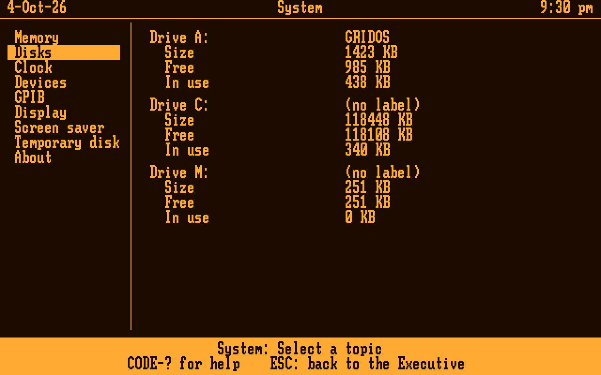

# Lodestone

A fast DOS 3.30-compatible OS for the GRiDCase 1520 (80C286, 640×400 gas-plasma display, 1.44 MB floppy; Joshua's also has an 80287 and 1408 KB of EMS). It has a GRiD-style Executive, a disk cache, a built-in GPIB driver, its own EMS manager, the internal hard disk as drive C:, a RAM disk in EMS as M:, and a screen saver that defragments every disk. Programs of its own (System and Write) run on a shared UI core.

> **Name:** Lodestone is the working name. The code, the files on the floppy and the screen still say **Grid-OS** (`GRIDOS.SYS`, "Grid-OS 0.3"). Renaming those is a separate step.

It boots from a floppy, shows the Executive, runs ordinary DOS programs (TM5000G, CLAUDE.COM, …) and comes back. On the real 1520 it runs the BENCH file-system benchmark in **87 s against GRiD MS-DOS's 289 s**, more than 3× faster (83 s with 0.2.3).

| | |
|---|---|
|  |  |
| The Executive: GRiD's File form (Device, Subject, Title), the 1520's EMS and serial mouse in the status line | Copy, Move and Delete take wildcards, with Replace and Only newer |
|  |  |
| System: where the 640 KB goes, and the EMS | System: the floppy, the internal hard disk as C: (the 1520's own 121 MB Conner layout) and M:, the RAM disk |
|  |  |
| Write, a GRiDWrite-style editor | BENCH 1.4 on Grid-OS with EMS |

*Emulator screenshots (`gridos/screens/readme_shots.py`), drawn as the 1520's amber plasma shows them.*

## What it does (0.3.15)

- **A DOS 3.30 kernel** (`GRIDOS.SYS`, 45,438 bytes): INT 21h for the programs of its day, COM and EXE loading, TSRs, INT 24h, INT 25h/26h, FAT12 and FAT16.
- **Disks:**
  - **A:** and **B:** (the external floppy drive), with a cylinder read-ahead cache;
  - **C:**, any IDE drive with a FAT16 partition up to 2 GB, driven through its own registers. The 1520's BIOS only knows a few Conner models, so Grid-OS doesn't use it for this. With a drive, C: costs about 3 KB of memory; without one, nothing is loaded.
  - **M:**, the temporary disk: a RAM disk in EMS, 256 KB unless System's Temporary disk topic or `MDISK=` in `GRIDOS.INI` says otherwise (Off up to all the free EMS). It costs DOS programs no memory: its 0.3 KB comes out of the environment's block, which programs never got. Its files are lost at power-off.
- **EMS:** Grid-OS is its own LIM 4.0 EMS manager when the 1520's memory is set to EMS. The disk cache moves into two EMS pages, so DOS programs get 16 KB more.
- **GPIB:** the GRIDGPIB API on INT 60h is built in, with a faster block transfer. TM5000G and CLAUDE.COM run unchanged.
- **The Executive:** GRiD's File form, with CODE-C Copy, CODE-M Move, CODE-R Rename and CODE-D Delete. They take wildcards, Replace and Only newer, and work on whole subjects (directories) too. CODE-P opens the command prompt (`GRIDCMD.COM`), CODE-U opens System, CODE-A starts Claude.
- **System:** memory, disks, clock, devices (the hard disk's own name), GPIB, display (fonts), screen saver, temporary disk. Settings are kept in `GRIDOS.INI`.
- **Write:** a GRiDWrite-style text editor.
- **The screen saver** runs `DEFRAG` on A:, B: and C: in turn, then darkens the screen. A key stops it. Its delay and the tidying are settings.
- **DEFRAG.COM:** defragments a floppy or C:, with a map of the disk. `/T` tests the free space instead: it writes a pattern into every free sector, reads it back, and marks the clusters that fail. A power cut during any of its writes leaves the old file or the new one, never a damaged one (tested at every write, on a floppy and on C:).
- **Screen capture:** Shift-PrtSc saves the screen to `SCREENnn.BMP` (graphics) or `SCREENnn.TXT` (text) on the boot disk.
- **An INT 33h mouse** for DOS programs: a serial mouse on COM1 or COM2.
- **Claude for GRiD** (`gridos/claude`, `claude-link`): Claude on the GRiD through a Raspberry Pi on the GPIB bus. It can read and edit files, run DOS programs and talk to instruments, each step confirmed on the GRiD. It is tested in emulation and waits for the bridge hardware.

## Benchmarks: Grid-OS, GRiD MS-DOS 3.30 and FreeDOS

BENCH 1.4 on all three in the emulator (rerun 2026-10-08 with 0.3.14), from the same kind of 1.44 MB floppy, with the 1520's real-drive timing (300 rpm, seeks, rotation, motor) and its 1408 KB of EMS. Grid-OS runs its own EMS manager; GRiD MS-DOS and FreeDOS load GRiD's `EMM.SYS`. FreeDOS is kernel build 2046 (8086) with FreeCOM 0.87, built from [FDOS](https://github.com/FDOS) sources. Seconds, lower is better.

| Test | Grid-OS 0.3.14 | GRiD MS-DOS 3.30 | FreeDOS |
|---|---:|---:|---:|
| Write 256 KB, 16 KB writes | **9.41** | 12.66 | 12.58 |
| Read 256 KB, 16 KB reads | **8.85** | 11.41 | 11.23 |
| Read 256 KB, 512-byte reads | **8.80** | 104.99 | 105.17 |
| Read 256 KB, 128-byte reads | **8.80** | 104.99 | 107.97 |
| 64 random 512-byte reads | **9.32** | 9.93 | 12.91 |
| Directory listing ×10 | **0.03** | 0.07 | 0.14 |
| Open + close ×100 | **0.22** | 0.42 | 0.91 |
| 20 small files, create + delete | 21.44 | 26.12 | **16.71** |
| Load + run a 120 KB .EXE ×3 | **11.98** | 14.68 | 15.29 |
| INT 21h calls ×1000 | **0.11** | 0.12 | 0.26 |
| **File-system total** | **79.0** | 285.4 | 283.2 |
| EMS: map a page ×10,000 | **0.43** | 2.87 | 2.87 |
| EMS: move 1 MB to EMS (57h) | **0.36** | 0.51 | 0.51 |
| EMS: move 1 MB from EMS (57h) | **0.36** | 0.51 | 0.51 |
| Memory for programs, no EMS | 562.5 KB | **580.4 KB** | 501.5 KB |
| Memory for programs, with EMS | **578.6 KB** | 573.1 KB | 494.2 KB |

- **Reads:** Grid-OS reads ahead a cylinder at a time, so small reads cost almost nothing; GRiD MS-DOS and FreeDOS wait a turn of the disk for each.
- **Small files:** FreeDOS wins this one, with as many writes as Grid-OS. Part of it is where its files happen to land: its system files are bigger, which moves BENCH's files to where the FAT sector follows the directory sector. The rest is write order. Grid-OS writes the FAT before the directory entry at close, so a power cut can only lose clusters, never cross-link files. That costs a turn of the disk per file here.
- **EMS:** Grid-OS's EMS manager maps a page about 7× faster than `EMM.SYS` and moves data about 1.4× faster, in 1.9 KB of memory against 7.3 KB.
- **Memory:** with EMS, Grid-OS keeps its 18 KB disk cache in two EMS pages, so a DOS program gets more than under GRiD MS-DOS with `EMM.SYS`, with the same read speeds. Without EMS the cache stays in conventional memory and GRiD MS-DOS leaves 18 KB more. FreeDOS can't load high on a 286, and its shell is large.
- **Since 0.3.8:** the file-system total is unchanged (79.0 s against 79.1 s). Screen capture, the kernel's part of drive C:, the saver's round of the disks and copying subjects cost DOS programs 1.7 KB in all; M: costs them nothing. (The emulator now also charges the EMS page registers' I/O, which moves the EMS rows by 0.01 s for all three.)

### Memory, by configuration

What a DOS program gets when started from the Executive (MEMSZ; System's "Free for programs" shows 0.1 KB more), 0.3.14 in the emulator, with M: at its default 256 KB wherever there is EMS:

| | Floppies only | With EMS | With C: | With C: and EMS |
|---|---:|---:|---:|---:|
| Kernel (DOS, GPIB, and EMS / C: when there) | 30.6 KB | 32.5 KB | 33.9 KB | 35.4 KB |
| Executive and UI core | 34.7 KB | 34.4 KB | 34.7 KB | 34.4 KB |
| Temporary disk M: | | 0.3 KB + 256 KB of EMS | | 0.3 KB + 256 KB of EMS |
| Disk cache | 18.0 KB | 32 KB of EMS | 18.0 KB | 32 KB of EMS |
| **Free for programs** | **562.5 KB** | **578.6 KB** | **559.2 KB** | **575.7 KB** |

M:'s 0.3 KB comes out of the environment's block (counted with the Executive otherwise), which programs never got. The rows add up to more than 640 KB because 7.5 KB of the Executive's share is its directory buffer, lent to a DOS program while it runs, so it counts in both rows. From the command prompt (`GRIDCMD.COM` resident) a program gets 16.1 KB less. The Executive otherwise stays resident: Grid-OS is meant to become multitasking.

### On the hard disk (C:) and the RAM disk (M:)

**On the real 1520** (2026-10-08, Grid-OS 0.3.14): BENCH 1.4 from the 1.44 MB floppy, from the 121 MB Conner CP30104H as C:, and from M: at 1 MB. Seconds. BENCH times with the BIOS clock, so anything under about 0.2 s is only good to a tick (55 ms).

| Test | Floppy A: | Hard disk C: | RAM disk M: |
|---|---:|---:|---:|
| Write 256 KB, 16 KB writes | 12.52 | 0.87 | **0.16** |
| Read 256 KB, 16 KB reads | 9.44 | 0.43 | **0.10** |
| Read 256 KB, 512-byte reads | 9.61 | 0.71 | **0.27** |
| Read 256 KB, 128-byte reads | 9.83 | 1.42 | **0.93** |
| 64 random 512-byte reads | 10.27 | 1.09 | **0.16** |
| Directory listing ×10 | 0.38 | 0.10 | **0.00** |
| Open + close ×100 | 0.10 | 0.16 | **0.10** |
| 20 small files, create + delete | 22.63 | 3.57 | **0.10** |
| Load + run a 120 KB .EXE ×3 | 12.74 | 0.65 | **0.16** |
| INT 21h calls ×1000 | 0.05 | 0.05 | 0.05 |
| **Total** | **87.6** | **9.1** | **2.1** |

- **C: is about 10× faster than the floppy, and M: about 42×.** Writing 256 KB takes 12.5 s on the floppy, 0.87 s on C: and 0.16 s on M:. Twenty small files take 22.6 s, 3.6 s and 0.1 s.
- **The CP30104H reads ahead on its own.** 512-byte reads on C: take 0.71 s, not the 9.4 s a drive without look-ahead would take, so Grid-OS's read-ahead doesn't need to cover C:.
- Logs: `gridos/bench/BENCH_1520_2026-10-08_A.TXT`, `_C.TXT` and `_M.TXT`.

**In the emulator** (`python3 gridos/bench/run_bench_hd.py`): C: is modelled on the same drive (3,360 rpm, 39 sectors a track, seeks), with and without the drive's own look-ahead. Seconds.

| Test | Floppy A: | C:, drive without look-ahead | C:, drive with look-ahead | M: |
|---|---:|---:|---:|---:|
| Write 256 KB, 16 KB writes | 9.41 | 0.76 | 0.74 | **0.18** |
| Read 256 KB, 16 KB reads | 8.85 | 0.56 | 0.35 | **0.11** |
| Read 256 KB, 512-byte reads | 8.80 | 9.39 | 0.96 | **0.35** |
| Read 256 KB, 128-byte reads | 8.80 | 9.37 | 1.89 | **1.26** |
| 64 random 512-byte reads | 9.32 | 1.02 | 1.03 | **0.31** |
| Directory listing ×10 | 0.03 | 0.02 | 0.02 | **0.01** |
| Open + close ×100 | 0.22 | 0.22 | 0.22 | **0.20** |
| 20 small files, create + delete | 21.44 | 2.71 | 2.71 | **0.18** |
| Load + run a 120 KB .EXE ×3 | 11.98 | 0.85 | 0.53 | **0.16** |
| INT 21h calls ×1000 | 0.11 | 0.11 | 0.11 | 0.11 |
| **Total** | **79.0** | **25.0** | **8.6** | **2.9** |

- **The look-ahead column matches the real drive:** 8.6 s modelled against 9.1 s measured.
- **The emulator overstates the kernel's own work about twice.** The 1,000 INT 21h calls take 0.11 s there and 0.05 s on the 1520, which is why M: is 2.9 s in the emulator and 2.1 s for real. Disk-bound tests are close.
- The model and notes are in `gridos/bench/RESULTS_HD.TXT`.

### On the real 1520

BENCH on Joshua's GRiDCase 1520, from its own 1.44 MB floppy (seconds). These are the latest runs on the machine. In the emulator, 0.3.14's floppy times are the same as 0.3.8's, so these still stand. The real machine runs a few seconds slower than the emulator; totals also move with where BENCH's files land on a well-used floppy (below).

| Test | GRiD MS-DOS 3.30 | Grid-OS 0.2.3, 2026-10-05 | Grid-OS 0.3.8, 2026-10-07 | the same, after DEFRAG |
|---|---:|---:|---:|---:|
| Write 256 KB, 16 KB writes | 13.89 | 12.35 | 12.90 | 12.63 |
| Read 256 KB, 16 KB reads | 11.97 | 8.73 | 9.55 | 9.17 |
| Read 256 KB, 512-byte reads | 104.86 | 8.56 | 9.55 | 8.95 |
| Read 256 KB, 128-byte reads | 104.86 | 8.78 | 9.77 | 8.95 |
| 64 random 512-byte reads | 10.49 | 9.61 | 10.05 | 9.72 |
| Directory listing ×10 | 0.21 | 0.05 | 0.54 | 0.05 |
| Open + close ×100 | 0.21 | 0.16 | 0.10 | 0.16 |
| 20 small files, create + delete | 28.45 | 22.30 | 22.13 | 24.88 |
| Load + run a 120 KB .EXE ×3 | 14.06 | 12.02 | 12.08 | 16.47 |
| INT 21h calls ×1000 | 0.10 | 0.05 | 0.05 | 0.05 |
| **Total** | **289.15** | **82.66** | **86.78** | **91.07** |
| Memory for programs (BENCH) | 571 KB | 554 KB | **580 KB** (with EMS) | 580 KB |
| EMS: map a page ×10,000 | | | 0.27 | 0.21 |
| EMS: move 1 MB to / from EMS | | | 0.38 / 0.32 | 0.38 / 0.32 |

- **Memory:** with the disk cache in EMS, a DOS program gets 580 KB on the real machine, 9 KB more than under GRiD MS-DOS (571 KB with its usual drivers), while Grid-OS also runs its own EMS manager, the cache and the Executive.
- **EMS on the real 1520:** a page map takes about 21–27 µs, and 57h moves run at 2.7–3.1 MB/s. RAMSPEED measured EMS pages at the full speed of conventional memory (copy 3,074 KB/s).
- **The internal hard disk (a 121 MB Conner CP30104H):**
  - a read of every sector ran at 463 KB/s (HDSCAN);
  - `DEFRAG C:` took about 15 s;
  - `DEFRAG C: /T` tested all 117,577 KB free in about 15 minutes and fenced off the drive's one weak spot (14 clusters).
- **Run to run:** totals move by a few seconds with where BENCH's files land on a well-used floppy. After DEFRAG the free space starts further in, which is slower here: drive A:'s head 0 is marginal on the innermost tracks, so some tracks are read a sector at a time.

Logs: `gridos/bench/BENCH_1520_*.TXT`, `DEFRAG_1520_2026-10-07_C.TXT`, `EMSTEST_1520_2026-10-07.TXT`, and `rom/HDSCAN_*.TXT`.

Run the comparison with `python3 gridos/bench/compare3.py <GRiD MS-DOS EPROM image> <EMM.SYS>` (about 4 minutes); results and notes are in `gridos/bench/RESULTS3.TXT`, newest first. The earlier two-way runs, and the runs on the real 1520, are in `gridos/bench/RESULTS.TXT`.

## What's here

| Folder | What |
|---|---|
| `gridos/src` | The OS, in NASM: the boot sector (`BOOT.ASM`), `GOSBOOT.COM` (installs it), the kernel (`GRIDOS.ASM` + `K*.INC`: `KEMS.INC` the EMS manager, `KHD.INC` the hard disk, `KMDISK.INC` the RAM disk M:, `KGPIB.INC` GPIB), the UI core (`UICORE.INC`, its API in `UIAPI.INC`) and the Executive (`EXEC.INC`), the shell `GRIDCMD.COM`, `DEFRAG.COM`, `HEADCLN.COM` (drive head cleaning with a wet cleaning disk) |
| `gridos/apps` | Programs on the UI core (`.RUN`, built with `gridos/mkrun.py`): `SYSTEM.RUN` and `WRITE.RUN` |
| `gridos/fonts` | `TERMINUS.FNT`, an 8×16 font System can switch to (GRiD's own is built in) |
| `gridos/tests` | `pcemu`-based tests (the counts are under Tests below), and the DOS programs they run: TESTDOS, CACHETST, CAPTEST, EMSTEST, HDABS, HDFLUSH, MDTEST, MEMSZ, TSR, UPPER, the M33 programs, UITEST.RUN |
| `gridos/bench` | BENCH.COM, DISKMAP.COM, `run_bench.py` (against GRiD MS-DOS), `compare3.py` (against GRiD MS-DOS and FreeDOS, with EMS; FreeDOS's files in `bench/freedos`), `run_bench_hd.py` (on C: and M:), profiling tools, `RESULTS.TXT`, `RESULTS3.TXT`, `RESULTS_HD.TXT` and the 1520 logs |
| `gridos/claude` | CLAUDE.COM, Claude for GRiD (the GRiD side of claude-link) |
| `gridos/releases` | Builds for the floppy, 0.1 to 0.3.15 |
| `gridos/screens` | Emulator screenshots (`readme/` for this page, made by `readme_shots.py`) |
| `gridos/*.py` | `pcemu.py` (a BIOS-level PC in unicorn: INT 13h with real-drive timing, mode 40h, the 7210 GPIB chip, EMS, an IDE drive with optional seek and rotation timing), `ktest.py`, `mkimg.py`, `mkrun.py`, `psf.py`, `sim7210.py`, `typfont.py` (builds the fonts); `gosim.py` and `test_*.py` are the 0.1 harness |
| `claude-link` | `gridlink` on the Raspberry Pi: GRiD ↔ GPIB (AR488 Nano) ↔ Pi ↔ Claude API, the AR488 patch, and its tests |
| `tools` | 1520 tools: GRIDGPIB (GPIB driver for GRiD MS-DOS), GPIBSCAN, GPIBTEST, GGTEST, GRIDMEM (EMS or extended memory), EMSKEEP (does EMS keep its contents through Ctrl-Alt-Del?), MEMPROBE, GRIDPROBE, RAMSPEED, ROMDUMP, HDPROBE and HDSCAN (the internal hard disk, read-only: diagnosis, and a read of every sector), the C GPIB library, and TM5000G.EXE (a test fixture; its source lives in the TM5000 repo) |
| `rom` | Our notes on the 1520 BIOS (a symbol map), probe and scan logs, and the hard disk's partition and boot sectors; no ROM images (see below) |
| `docs` | Design notes: the 0.2 kernel, the UI core and programs (0.3, with EMS, screen capture, the hard disk and M:), DEFRAG and the saver, the floppy development loop |

## Build

Needs NASM 2.15+, and Python 3 for the `.RUN` programs (`mkrun.py`).

```sh
gridos/build.sh        # everything in gridos/src, apps, tests and bench
gridos/kbuild.sh       # just the kernel, with GRIDOS.MAP / .LST
cd gridos/claude && ./build.sh
```

The built binaries are committed too, so a fresh clone can go straight onto a floppy.

## Tests (emulator)

Needs Python 3, `unicorn` 2.x and mtools. All 733 checks pass on 0.3.15 (2026-10-08).

```sh
cd gridos
python3 tests/test_kernel.py          # 178 checks: DOS calls, files, EXEC, the cache, EMS, capture, M:
python3 tests/test_apps.py            # 367 checks: UI core, Executive, System, Write, mouse, files (add "shots" for screens/0.3)
python3 tests/test_hd.py              # 56 checks: drive C:, and C: with M:
python3 tests/test_defrag.py          # 49 checks: DEFRAG on floppies and C:, the saver's round
python3 tests/test_claude_kernel.py   # 21 Claude-link scenarios on the kernel
python3 tests/test_hdprobe.py         # 33 checks: HDPROBE
python3 tests/test_hdscan.py          # 20 checks: HDSCAN
python3 tests/test_headcln.py         # 9 checks: HEADCLN
python3 tests/defrag_cut.py 2         # a power cut at every DEFRAG write (~20 min; "2 hd" for C:, "2 worn" for a worn drive)
python3 bench/run_bench.py <GRiD MS-DOS EPROM image>
python3 bench/run_bench_hd.py         # BENCH on C: and M:
```

Some tests need files that aren't in this repo: the GRiD MS-DOS EPROM image (`GRID_ROM=…`, or `rom/GRID_MSDOS330_ROM_300909-00.BIN`). Without it, those checks are skipped.

## On the GRiD (the floppy loop)

1. Format a 1.44 MB floppy and copy `GRIDOS.SYS`, `GRIDCMD.COM`, `DEFRAG.COM`, `SYSTEM.RUN`, `WRITE.RUN` and whatever programs you want.
2. Under GRiD MS-DOS (EPROM boot, where the floppy is B:), run `B:GOSBOOT B` once per format.
3. Restart and tap **F** as the memory count finishes: the 1520 boots the floppy.
4. A new `GRIDOS.SYS` can simply be copied over; the boot sector follows the FAT chain.

Keep `COMMAND.COM`, `CONFIG.SYS` and `AUTOEXEC.BAT` off this floppy unless they're meant for GRiD MS-DOS: booted from the EPROM with the floppy in, GRiD MS-DOS uses them from the floppy. See `docs/gridos-floppy-dev.md`.

## Not in this repo

These aren't ours to publish, even privately: the 1520 BIOS and GRiD MS-DOS ROM dumps, the GRiD MS-DOS disks and utilities, the vendor GPIB driver package (Driver488), and the floppy backups. They stay on the development PC. `.gitignore` keeps ROM images and disk images out.

## Status

Grid-OS 0.3.13 runs on the 1520: it boots, runs TESTDOS, TM5000G and CLAUDE.COM, uses the internal hard disk as C:, and the screen saver tidies every disk. 0.3.14 adds M:, the RAM disk: Claude's future scratchpad, and fast scratch space now. It is tested in the emulator and waits for the 1520, along with `EMSKEEP.COM`, which finds out whether EMS keeps M:'s files through Ctrl-Alt-Del. See `docs/gridos-0.3-apps.md` for 0.3 release by release.

**Next:**
1. Claude on the real GPIB bridge.
2. Claude staying resident, working alongside DOS programs, with M: as its scratchpad.
3. Term and Command.

Later come a plot view and instrument programs for the GPIB bench (scopes, the VNA), and a calculator on the 80287. The roadmap and the hardware notes are in the claude.ai Project.
