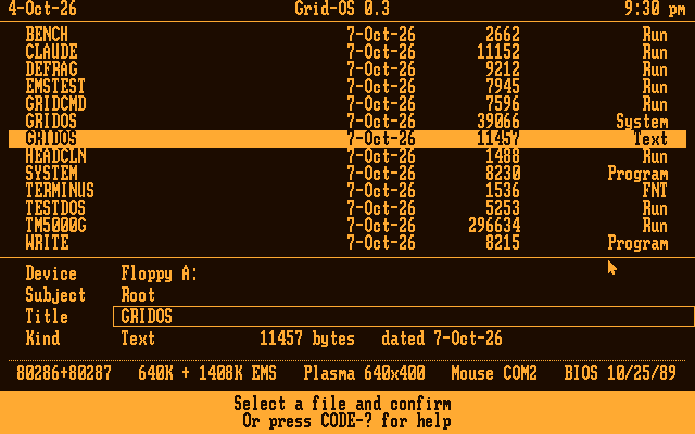
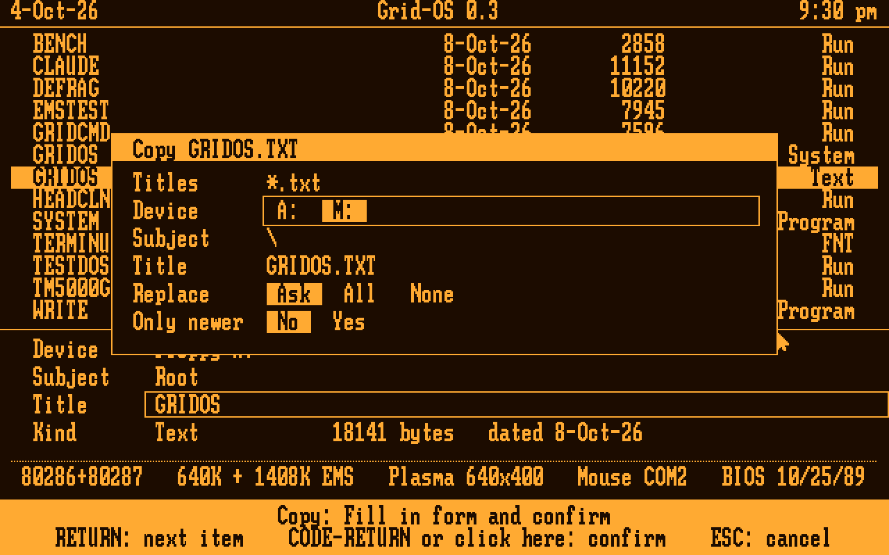
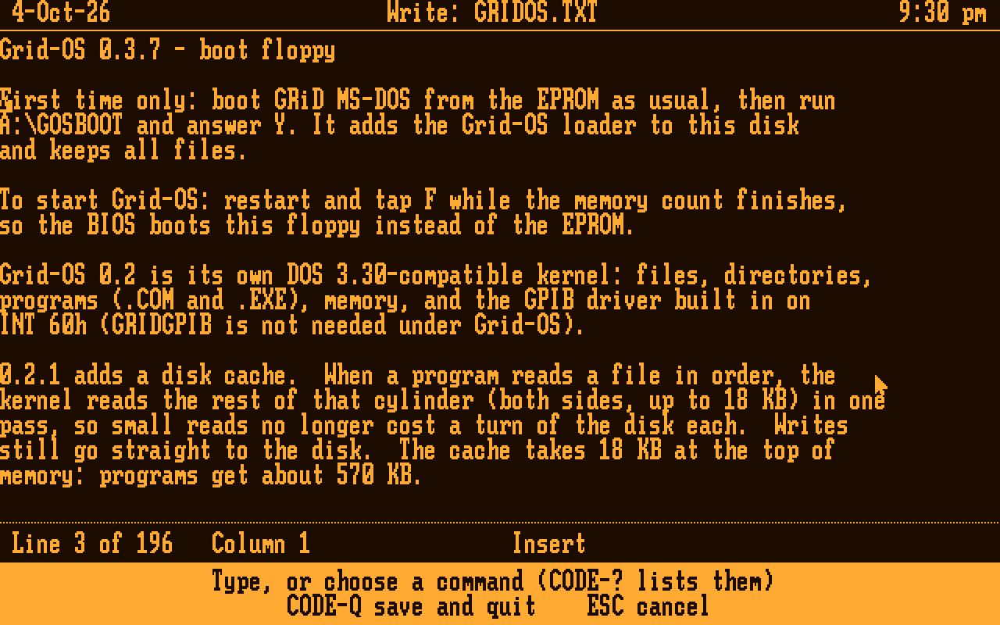
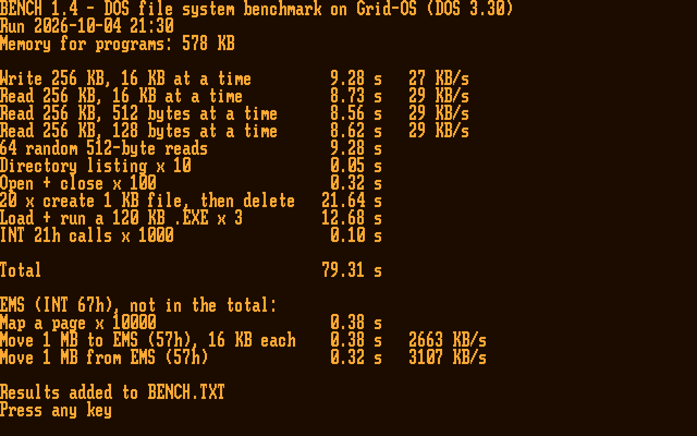

# Lodestone

A fast DOS 3.30-compatible OS for the GRiDCase 1520 (80C286, 640×400 gas-plasma display, 1.44 MB floppy). It has its own Executive, a disk cache, a built-in GPIB driver, a screen saver that defragments the floppy, and (from 0.3) a shared UI core with programs of its own: System and Write.

> **Name:** Lodestone is the working name. The code, the files on the floppy and the screen still say **Grid-OS** (`GRIDOS.SYS`, "Grid-OS 0.3"). Renaming those is a separate step.

It boots from a floppy, shows a GRiD-style Executive, runs ordinary DOS programs (TM5000G, CLAUDE.COM, …) and comes back. On the real 1520 it runs the BENCH file-system benchmark in **83 s against GRiD MS-DOS's 289 s**, and it's ahead on all ten tests.

| | |
|---|---|
|  |  |
| The Executive: GRiD's File form (Device, Subject, Title), the 1520's EMS and serial mouse in the status line | Copy, Move and Delete take wildcards, with Replace and Only newer |
|  |  |
| System: where the 640 KB goes, and the EMS | Write, a GRiDWrite-style editor |

*Emulator screenshots (`gridos/screens/readme_shots.py`), drawn as the 1520's amber plasma shows them.*

## Benchmarks: Grid-OS, GRiD MS-DOS 3.30 and FreeDOS

BENCH 1.3 on all three in the emulator, from the same kind of 1.44 MB floppy, with the 1520's real-drive timing (300 rpm, seeks, rotation, motor) and its 1408 KB of EMS. Grid-OS runs its own EMS manager; GRiD MS-DOS and FreeDOS load GRiD's `EMM.SYS`. FreeDOS is kernel build 2046 (8086) with FreeCOM 0.87, built from [FDOS](https://github.com/FDOS) sources. Seconds, lower is better.

| Test | Grid-OS 0.3.8 | GRiD MS-DOS 3.30 | FreeDOS |
|---|---:|---:|---:|
| Write 256 KB, 16 KB writes | **9.14** | 12.66 | 12.58 |
| Read 256 KB, 16 KB reads | **8.71** | 11.41 | 11.23 |
| Read 256 KB, 512-byte reads | **8.62** | 104.99 | 105.17 |
| Read 256 KB, 128-byte reads | **8.64** | 104.99 | 107.97 |
| 64 random 512-byte reads | **9.47** | 9.93 | 12.91 |
| Directory listing ×10 | **0.02** | 0.07 | 0.14 |
| Open + close ×100 | **0.22** | 0.42 | 0.91 |
| 20 small files, create + delete | 21.59 | 26.12 | **16.71** |
| Load + run a 120 KB .EXE ×3 | **12.64** | 14.68 | 15.29 |
| INT 21h calls ×1000 | **0.10** | 0.12 | 0.26 |
| **File-system total** | **79.1** | 285.4 | 283.2 |
| EMS: map a page ×10,000 | **0.42** | 2.86 | 2.86 |
| EMS: move 1 MB to EMS (57h) | **0.36** | 0.51 | 0.51 |
| EMS: move 1 MB from EMS (57h) | **0.36** | 0.51 | 0.51 |
| Memory for programs, no EMS | 564.2 KB | **580.4 KB** | 501.5 KB |
| Memory for programs, with EMS | **580.3 KB** | 573.1 KB | 494.2 KB |

- **Reads:** Grid-OS reads ahead a cylinder at a time, so small reads cost almost nothing; GRiD MS-DOS and FreeDOS wait a turn of the disk for each.
- **Small files:** FreeDOS wins this one, with as many writes as Grid-OS. Part of it is where its files happen to land (its system files are bigger, which moves BENCH's files to where the FAT sector follows the directory sector). The rest is write order: Grid-OS writes the FAT before the directory entry at close, so a power cut can only lose clusters, never cross-link files. That costs a turn of the disk per file here.
- **EMS:** Grid-OS's own EMS manager maps a page about 7× faster than `EMM.SYS` and moves data about 1.4× faster, in 1.9 KB of memory against 7.3 KB.
- **Memory:** with EMS, Grid-OS keeps its 18 KB disk cache in two EMS pages, so a DOS program gets **580.3 KB**, more than GRiD MS-DOS with `EMM.SYS` (573.1 KB), with the same read speeds. Without EMS the cache stays in conventional memory and GRiD MS-DOS leaves 16 KB more. FreeDOS can't load high on a 286, and its shell is large.



### On the real 1520

BENCH on Joshua's GRiDCase 1520, from its own 1.44 MB floppy (seconds). The 2026-10-07 runs use the 0.3.8 kernel, which keeps the disk cache in EMS.

| Test | GRiD MS-DOS 3.30 | Grid-OS 0.2.3, 2026-10-05 | Grid-OS 0.3.8, 2026-10-07 | the same, after DEFRAG |
|---|---:|---:|---:|---:|
| Write 256 KB, 16 KB writes | 13.89 | 12.35 | 12.90 | 12.63 |
| Read 256 KB, 16 KB reads | 11.97 | 8.73 | 9.55 | 9.17 |
| Read 256 KB, 512-byte reads | 104.86 | 8.56 | 9.55 | 8.95 |
| Read 256 KB, 128-byte reads | 104.86 | 8.78 | 9.77 | 8.95 |
| 64 random 512-byte reads | 10.49 | 9.61 | 10.05 | 9.72 |
| Directory listing ×10 | 0.21 | 0.05 | 0.54 | 0.05 |
| Open + close ×100 | 0.21 | 0.16 | 0.10 | 0.16 |
| 20 small files, create + delete | 28.45 | 22.30 | 22.13 | 24.88 |
| Load + run a 120 KB .EXE ×3 | 14.06 | 12.02 | 12.08 | 16.47 |
| INT 21h calls ×1000 | 0.10 | 0.05 | 0.05 | 0.05 |
| **Total** | **289.15** | **82.66** | **86.78** | **91.07** |
| Memory for programs (BENCH) | 571 KB | 554 KB | **580 KB** (with EMS) | 580 KB |
| EMS: map a page ×10,000 | | | 0.27 | 0.21 |
| EMS: move 1 MB to / from EMS | | | 0.38 / 0.32 | 0.38 / 0.32 |

- **Memory:** with the disk cache in EMS (0.3.8), a DOS program gets 580 KB on the real machine, 9 KB more than under GRiD MS-DOS (571 KB), while Grid-OS also runs its own EMS manager, the cache and the Executive.
- **EMS on the real 1520:** a page map takes about 21–27 µs, and 57h moves run at 2.7–3.1 MB/s.
- **Run to run:** totals move by a few seconds with where BENCH's files land on a well-used floppy. After DEFRAG the free space starts further in, which is slower here: drive A:'s head 0 is marginal on the innermost tracks, so some tracks are read a sector at a time.

Logs: `gridos/bench/BENCH_1520_2026-10-05*.TXT` and `BENCH_1520_2026-10-07.TXT`.

Run it with `python3 gridos/bench/compare3.py <GRiD MS-DOS EPROM image> <EMM.SYS>` (about 4 minutes); details and notes in `gridos/bench/RESULTS3.TXT`. The earlier two-way runs, and the runs on the real 1520, are in `gridos/bench/RESULTS.TXT`.

## What's here

| Folder | What |
|---|---|
| `gridos/src` | The OS, in NASM: boot sector (`BOOT.ASM`), `GOSBOOT.COM` (installs the boot sector), the kernel (`GRIDOS.ASM` + `K*.INC`), the UI core (`UICORE.INC`, its API in `UIAPI.INC`) and the Executive (`EXEC.INC`), the shell `GRIDCMD.COM`, `DEFRAG.COM`, `HEADCLN.COM` (drive head cleaning with a wet cleaning disk) |
| `gridos/apps` | Programs on the UI core (`.RUN`, built with `gridos/mkrun.py`): `SYSTEM.RUN` (Usage: memory, disks, clock, devices, GPIB) and `WRITE.RUN` (a GRiDWrite-style editor) |
| `gridos/tests` | `pcemu`-based tests: kernel (120 checks), the UI core, programs and INT 33h (294), DEFRAG (33) and a power cut at every DEFRAG write, HEADCLN (9), the Claude-link scenarios, GGTEST; also TESTDOS / CACHETST / CAPTEST / UPPER / MEMSZ / TSR / M33TEST and the other M33 programs (DOS programs) and UITEST.RUN |
| `gridos/bench` | BENCH.COM, DISKMAP.COM, `run_bench.py` (Lodestone against GRiD MS-DOS in the emulator), `compare3.py` (against GRiD MS-DOS and FreeDOS, with EMS; FreeDOS's files in `bench/freedos`), profiling tools, `RESULTS.TXT`, `RESULTS3.TXT` and the 1520 logs |
| `gridos/claude` | CLAUDE.COM, Claude for GRiD (the GRiD side of claude-link) |
| `gridos/releases` | Builds that went onto the floppy, 0.1 to 0.3.9 |
| `gridos/screens` | Emulator screenshots (`readme/` for this page, made by `readme_shots.py`) |
| `gridos/*.py` | `pcemu.py` (a BIOS-level PC in unicorn: INT 13h with real-drive timing, mode 40h, 7210 GPIB model), `ktest.py`, `mkimg.py`, `psf.py`, `sim7210.py`; `gosim.py` and `test_*.py` are the 0.1 harness |
| `claude-link` | `gridlink` on the Raspberry Pi: GRiD ↔ GPIB (AR488 Nano) ↔ Pi ↔ Claude API, the AR488 patch, and its tests |
| `tools` | 1520 tools: GRIDGPIB (GPIB driver for GRiD MS-DOS), GPIBSCAN/GPIBTEST/GGTEST, MEMPROBE, GRIDPROBE, RAMSPEED, ROMDUMP, the C GPIB library, and TM5000G.EXE (a test fixture; its source lives in the TM5000 repo) |
| `rom` | Our notes on the 1520 BIOS (a symbol map) and a hardware probe log; no ROM images (see below) |
| `docs` | Design notes: kernel, the UI core and programs (0.3), DEFRAG and the saver, the floppy development loop |

## Build

Needs NASM 2.15+, and Python 3 for the `.RUN` programs (`mkrun.py`).

```sh
gridos/build.sh        # everything in gridos/src, apps, tests and bench
gridos/kbuild.sh       # just the kernel, with GRIDOS.MAP / .LST
cd gridos/claude && ./build.sh
```

The built binaries are committed too, so a fresh clone can go straight onto a floppy.

## Tests (emulator)

Needs Python 3, `unicorn` 2.x and mtools.

```sh
cd gridos
python3 tests/test_kernel.py          # 120 checks
python3 tests/test_apps.py            # 294 checks (add "shots" for screens/0.3)
python3 tests/test_defrag.py          # 33 checks
python3 tests/defrag_cut.py 2         # power cut at every DEFRAG write (~20 min)
python3 tests/defrag_cut.py 2 worn    # the same on a simulated worn drive
python3 tests/test_claude_kernel.py   # Claude-link scenarios on the kernel
python3 bench/run_bench.py <GRiD MS-DOS EPROM image>
```

Some tests need files that aren't in this repo: the GRiD MS-DOS EPROM image (`GRID_ROM=…`, or `rom/GRID_MSDOS330_ROM_300909-00.BIN`). Without it, those checks are skipped.

## On the GRiD (the floppy loop)

1. Format a 1.44 MB floppy and copy `GRIDOS.SYS`, `GRIDCMD.COM`, `DEFRAG.COM`, `SYSTEM.RUN`, `WRITE.RUN` and whatever programs you want.
2. Under GRiD MS-DOS (EPROM boot, where the floppy is B:), run `B:GOSBOOT B` once per format.
3. Restart and tap **F** as the memory count finishes: the 1520 boots the floppy.
4. A new `GRIDOS.SYS` can simply be copied over; the boot sector follows the FAT chain.

Keep `COMMAND.COM`, `CONFIG.SYS` and `AUTOEXEC.BAT` off this floppy unless they're meant for GRiD MS-DOS: booted from the EPROM with the floppy in, GRiD MS-DOS uses them from the floppy. See `docs/gridos-floppy-dev.md`.

## Not in this repo

These aren't ours to publish, even privately: the 1520 BIOS and GRiD MS-DOS ROM dumps, the GRiD MS-DOS disks and utilities, the vendor GPIB driver package (Driver488), and the floppy backups. They stay on the development PC. `.gitignore` keeps ROM images and disk images out.

## Status

Grid-OS 0.3.9 runs on the 1520. It boots, runs TESTDOS, TM5000G and CLAUDE.COM, and the screen saver defragments the floppy.

0.3 put the Executive on a shared UI core and added System and Write, GRiD's font, the File form, file commands with wildcards (Copy, Move, Rename, Delete, subjects too), an INT 33h mouse for DOS programs, a settable screen saver, and Grid-OS's own LIM 4.0 EMS manager (EMSTEST: 22 passed on the 1520). 0.3.8 keeps the disk cache in EMS when there is EMS: DOS programs get about 580 KB with EMS, 564 KB without. 0.3.9 adds screen capture: Shift-PrtSc saves the screen to `SCREENnn.BMP` (graphics) or `SCREENnn.TXT` (text) on the boot disk. See `docs/gridos-0.3-apps.md`. Next: an EMS RAM disk, then Term and Command. The roadmap and the hardware notes are in the claude.ai Project.
