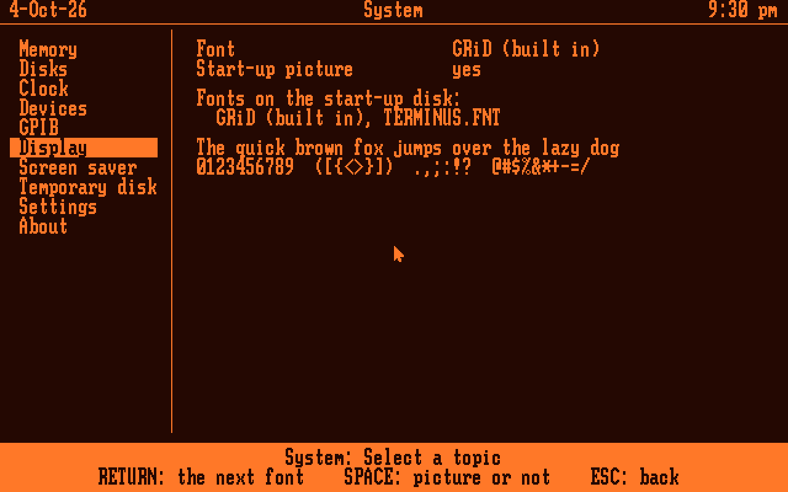
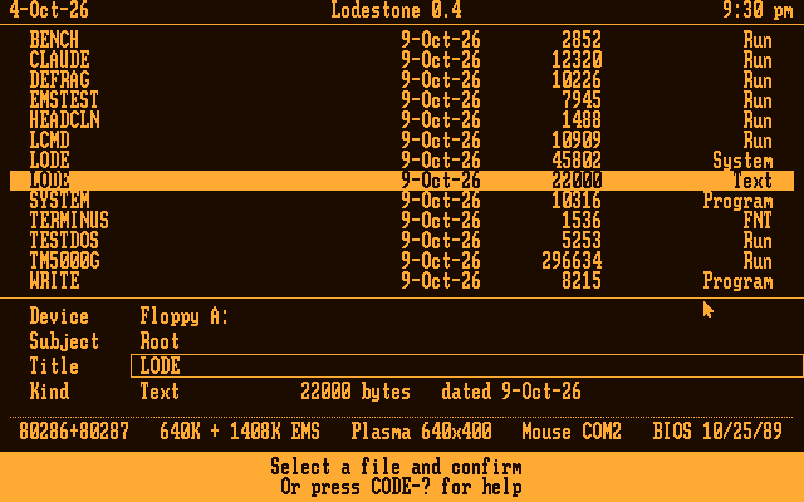
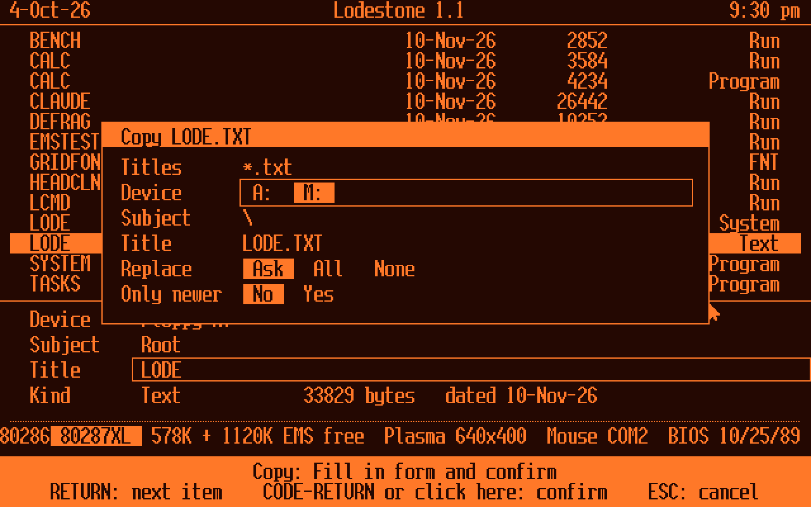
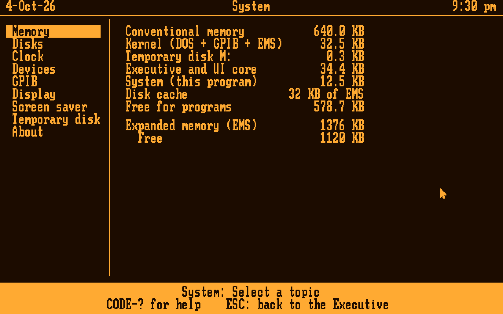
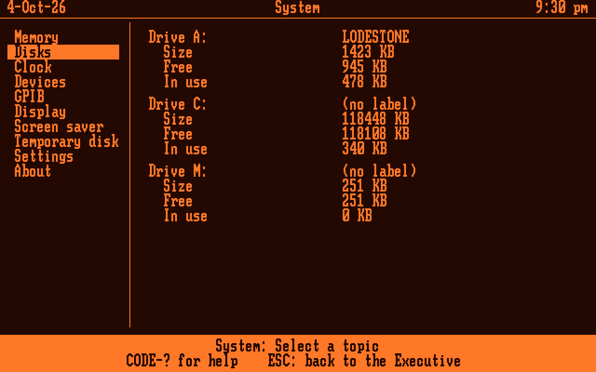
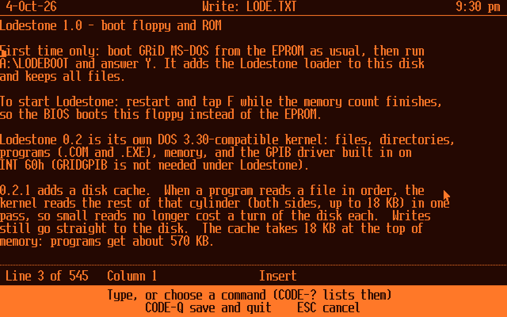
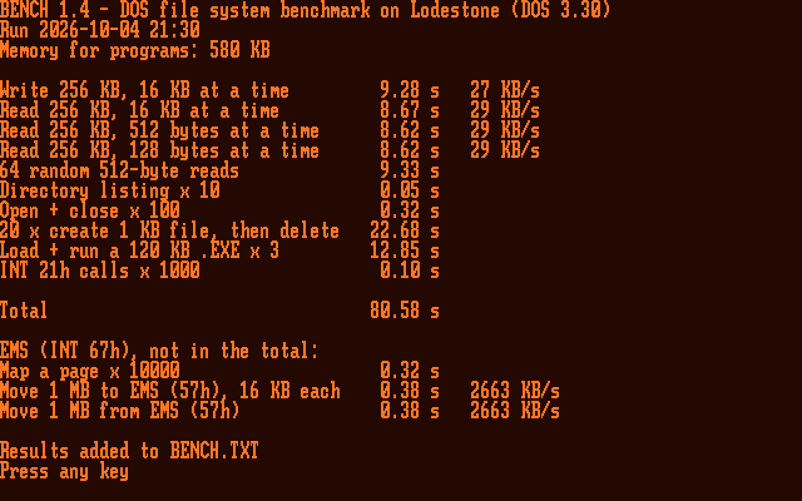
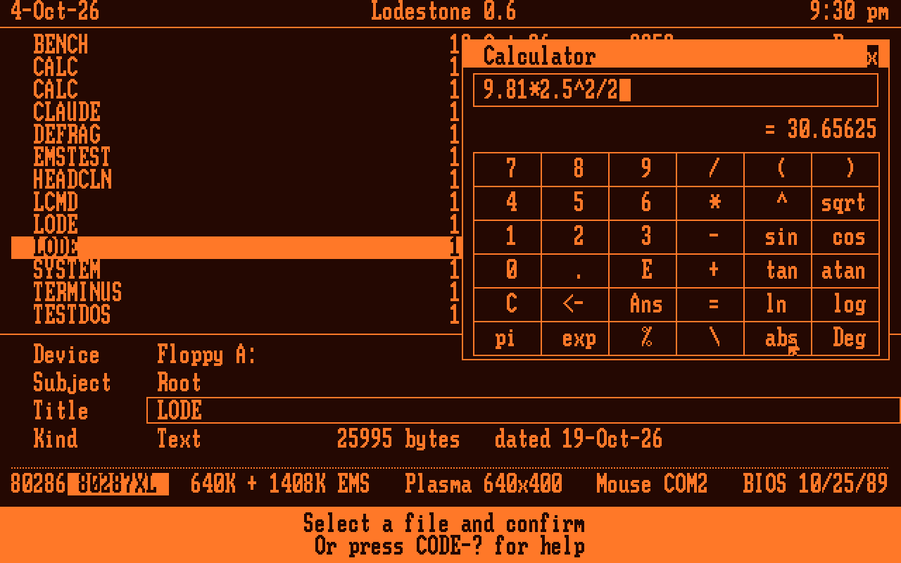
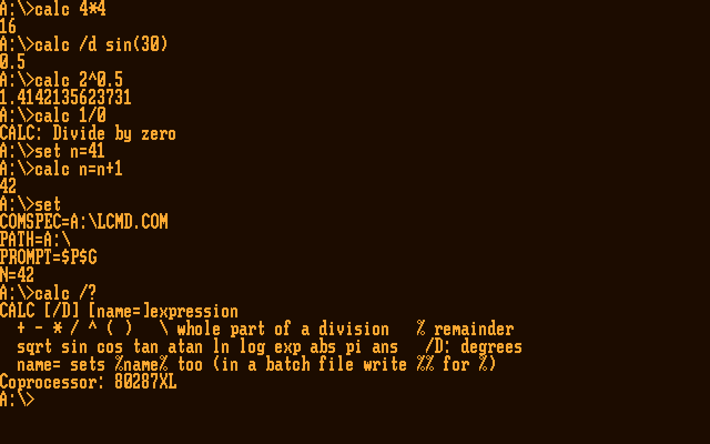

# Lodestone

A fast, DOS 3.30-compatible operating system for the GRiDCase 1520 (80C286, 640×400 gas-plasma display), with GRiD's own look and feel. It boots from an EPROM in the 1520's application-ROM socket, as GRiD MS-DOS did, or from a floppy. It runs the DOS programs of its day unchanged, more than three times faster on file work than GRiD MS-DOS, with more memory left for them.

Lodestone also connects the GRiD to Claude. Through a Raspberry Pi on the GPIB bus, Claude Code runs on the GRiD's screen and works with its files, its programs and the instruments on the bus.

| | |
|---|---|
|  |  |
| The start-up picture (`LODE.PIC`)¹ | System, Display: the font, and the start-up picture (Space turns it off) |
|  |  |
| The Executive: GRiD's File form (Device, Subject, Title), the 1520's EMS and serial mouse in the status line | Copy, Move and Delete take wildcards, with Replace and Only newer |
|  |  |
| System: where the 640 KB goes, and the EMS | System: the floppy, the internal hard disk as C: (the 1520's own 121 MB Conner layout) and M:, the RAM disk |
|  |  |
| Write, a GRiDWrite-style editor | BENCH 1.4 on Lodestone with EMS |
|  |  |
| The calculator over the Executive (CODE-K); the coprocessor lit in the info line (the emulator's is 387-class, so it reads as a 287XL) | `CALC` at the command prompt: sums, errors with ERRORLEVEL, `name=` for batch files |

*Emulator screenshots (`os/screens/readme_shots.py`), drawn as the 1520's amber plasma shows them.*

## What's in it

**The kernel** (`LODE.SYS`, about 46 KB)
- INT 21h for the programs of its day: COM and EXE loading, TSRs, INT 24h, INT 25h/26h, FAT12 and FAT16.
- A cylinder read-ahead cache for the floppies, kept in EMS when there is EMS.
- Its own LIM 4.0 EMS manager, when the 1520's memory is set to EMS.
- The GRIDGPIB driver API on INT 60h, built in, with a faster block transfer.
- An INT 33h driver for a serial mouse on COM1 or COM2.
- Screen capture: Shift-PrtSc saves the screen as `SCREENnn.BMP` (graphics) or `SCREENnn.TXT` (text).

**Drives**
- **A:** and **B:**, the internal and external floppy drives.
- **C:**, any IDE drive or CompactFlash card with a FAT16 partition up to 2 GB (DOS's limit, with 32 KB clusters). Lodestone drives it through its own registers, because the 1520's BIOS only knows a few Conner models. Without a drive, nothing is loaded.
- **M:**, a RAM disk in EMS (256 KB by default, up to all the free EMS). It costs DOS programs no memory. Its files are gone at power-off or restart.
- **R:**, the ROM drive, when Lodestone's EPROM is fitted. It is read-only, and is mapped in only while a sector is read.

**The Executive and its programs.** These run on one shared UI core, in GRiD's system font (other 8×16 fonts load from `.FNT` files).
- **The Executive:** GRiD's File form (Device, Subject, Title). CODE-C copies, CODE-M moves, CODE-R renames and CODE-D deletes, with wildcards, Replace and Only newer, on files or whole subjects.
- **System:** memory, disks, clock, devices, GPIB, display, screen saver, the temporary disk M:, and where the settings come from.
- **Write:** a GRiDWrite-style text editor.
- **The calculator** uses the 80287 or 287XL when one is fitted, and works with whole numbers when not. It runs as a window over the Executive (CODE-K), and as `CALC` at the prompt, for batch files.
- **The screen saver:** runs DEFRAG on every disk in turn, then darkens the screen.
- **A start-up picture**¹, drawn from vectors (`LODE.PIC`, 2.5 KB).

**The command prompt** (`LCMD.COM`)
- DOS 3.30's commands, with redirection and pipes, and `&&` and `||`.
- Line editing, history and Tab completion.
- A batch language: IF, GOTO, FOR, CALL, SHIFT, CHOICE and `%NAME%`.
- Every built-in that can fail sets ERRORLEVEL, so scripts can check each step. Claude writes scripts too.

**Tools**
- **`DEFRAG`:** defragments a floppy or C:. A power cut during any of its writes leaves the old file or the new one, never a damaged one. `DEFRAG /T` tests every free sector and fences off bad ones.
- **`HDPROBE` and `HDSCAN`:** diagnose an internal hard disk read-only, and can free a sticky Conner.
- **The rest:** BENCH, GRIDPROBE and others are in `tools/` and `os/bench/`.

**Settings** are kept in `LODE.INI`: the font, the screen saver, the start-up picture, M:'s size. From the ROM, the ROM's own `LODE.INI` gives the defaults, and changes go in `C:\LODE.INI` (A: without a hard disk).

## Claude on the GRiD

`claude-link` runs on a Raspberry Pi connected to the GPIB bus through a bridge: a Pico 2 board with its own firmware, or an AR488 Nano. On the GRiD, `CLAUDE.COM` gives several ways in:

- **Term (`CLAUDE /T`, or CODE-A in the Executive):** the GRiD is the screen and keyboard of the real Claude Code, running on the Pi on your own Claude plan. Only the screen cells that change cross the link. Claude Code's tools reach the GRiD's files, DOS programs, screen and GPIB instruments through an MCP server on the Pi. Instrument writes and file changes are confirmed on the GRiD.
- **Resident (`CLAUDE /R`):** Claude stays in memory (0.8 KB of conventional memory, the rest in EMS). CODE-\ pops Claude Code up over a running program such as TM5000G, and back again. In the pop-up, Claude Code can read the program's screen and type into it. File and GPIB tools aren't available in the pop-up yet.
- **Pictures and plots:** Claude Code can draw plots and pictures on the GRiD's screen in its font, such as an instrument trace fetched over GPIB.
- **gridfox (`CLAUDE /W`):** Firefox on the Pi, shown on the GRiD as text, with the mouse, and with pictures in a 1-bit view.
- **Chat (`CLAUDE`):** gridlink's own agent, on an API key, for a Pi too small for Claude Code.

The link runs at about 19 KB/s each way through the Pico 2 bridge. See `claude-link/README.md`, `docs/term.md`, `docs/lodestone-resident-claude.md`, `docs/lodestone-pictures.md` and `docs/gridfox.md`.

## Speed and memory

BENCH 1.4, a file-system benchmark, on the real 1520 from its 1.44 MB floppy: **Lodestone 83–91 s, GRiD MS-DOS 3.30 289 s.** Small reads make most of the difference. Lodestone reads a cylinder ahead, while GRiD MS-DOS waits a turn of the disk for each 512 bytes.

On the 1520, BENCH from each kind of drive, in seconds:

| Test | Floppy A: | Hard disk C: (Conner CP30104H) | RAM disk M: |
|---|---:|---:|---:|
| Write 256 KB, 16 KB writes | 12.52 | 0.87 | **0.16** |
| Read 256 KB, 512-byte reads | 9.61 | 0.71 | **0.27** |
| 20 small files, create + delete | 22.63 | 3.57 | **0.10** |
| Load + run a 120 KB .EXE ×3 | 12.74 | 0.65 | **0.16** |
| **All ten tests** | **87.6** | **9.1** | **2.1** |

Against GRiD MS-DOS 3.30 and FreeDOS (kernel 2046 with FreeCOM), all in the emulator with the 1520's drive timing and 1408 KB of EMS. Times are in seconds; lower is better.

| | Lodestone | GRiD MS-DOS 3.30 | FreeDOS |
|---|---:|---:|---:|
| BENCH file-system total | **79.0** | 285.4 | 283.2 |
| EMS: map a page ×10,000 | **0.43** | 2.87 | 2.87 |
| Memory for programs, with EMS | **578.6 KB** | 573.1 KB | 494.2 KB |
| Memory for programs, no EMS | 562.5 KB | **580.4 KB** | 501.5 KB |

**Memory:**
- **With EMS:** Lodestone keeps its 18 KB disk cache in EMS, so a DOS program gets more memory than under GRiD MS-DOS with `EMM.SYS`. That holds even though the Executive, the EMS manager and the cache all stay resident.
- **Without EMS:** the cache stays in conventional memory, so GRiD MS-DOS leaves programs 18 KB more.
- **Hard disk and ROM:** C: costs about 3 KB when a drive is there. R: costs 0.4 KB when the ROM is there.
- **The Executive stays resident on purpose:** Lodestone is meant to become multitasking.

The full tables, the method and every run on the 1520 are in `os/bench/RESULTS.TXT`, `RESULTS3.TXT` and `RESULTS_HD.TXT`, and the `BENCH_1520_*.TXT` logs.

## Installing on the GRiD

### From an EPROM

`os/build.sh` builds ROM 1, a 128 KB GRiD application ROM (a FAT12 volume in GRiD's own format). It holds the kernel, the command prompt, System, Write, the calculator, DEFRAG, a second font and the default settings.

1. Burn **`os/LODE1_EPROM.BIN`** to a 27C010 (the 1520's original part is a TMS27C010A). Don't burn `LODE1.BIN`: the 1520 inverts address line A16 to its ROM sockets, so the file to burn has its two halves swapped. The two have the same programmer checksum, so check the bytes: address 10000h starts `EB 3C 90` then `LODE ROM`.
2. Fit it in the **second** socket, where GRiD MS-DOS's EPROM sits. The BIOS boots the last bootable ROM it finds. GRiD MS-DOS can move to the first socket.
3. Hold **Shift** while the 1520 starts for the boot menu: Lodestone, Lodestone with the ROM's own settings, GRiD MS-DOS (from the other socket), or the floppy.

From the ROM, the current drive is C: (R: without a hard disk), and `PATH` is `C:\LODE;R:\`. So a newer program copied to `C:\LODE` is used before the ROM's copy, and an update needs no new ROM. CLAUDE.COM isn't in ROM 1 yet: copy it to `C:\LODE`. See `docs/lodestone-rom.md`.

### From a floppy

1. Format a 1.44 MB floppy and copy `LODE.SYS`, `LODE.PIC`, `LCMD.COM`, `DEFRAG.COM`, `SYSTEM.RUN`, `WRITE.RUN`, `CALC.RUN`, `CALC.COM` and whatever programs you want. The current release's files are in `os/releases/`.
2. Under GRiD MS-DOS, run `LODEBOOT` on it once (`B:LODEBOOT B` when booted from the EPROM, where the floppy is B:).
3. Restart and tap **F** as the memory count finishes, or choose the floppy from Lodestone's boot menu.
4. A new `LODE.SYS` can simply be copied over the old one.

See `docs/lodestone-floppy-dev.md`.

## What's here

| Folder | What |
|---|---|
| `os/src` | The OS, in NASM: the boot sector (`BOOT.ASM`), the ROM's boot sector (`ROMBOOT.ASM`), `KROM.INC` (R:, the ROM drive, and booting from the ROM), `LODEBOOT.COM` (installs it), the kernel (`LODE.ASM` + `K*.INC`: `KEMS.INC` the EMS manager, `KHD.INC` the hard disk, `KMDISK.INC` the RAM disk M:, `KGPIB.INC` GPIB, `KSPLASH.INC` the start-up picture's bootstrap), `SPLASH.ASM` (`LODE.PIC`, the picture), the UI core (`UICORE.INC`, its API in `UIAPI.INC`) and the Executive (`EXEC.INC`), the shell `LCMD.COM`, `DEFRAG.COM`, `HEADCLN.COM` (drive head cleaning with a wet cleaning disk), `CALC.COM` (the calculator at the prompt; its engine `CALC.INC`, and `FPU.INC`, which coprocessor) |
| `os/splash` | The start-up picture's source: the source image, `trace.txt` (the stone's outline and the nails, editable), `trace.py` (how they were traced), `mksplash.py` (packs them into `src/SPLASH.INC` and draws the picture the tests compare the GRiD's screen with, bit for bit) |
| `os/rom` | `LODE.INI`, the settings burned into the ROM. The ROM images are `os/LODE1_EPROM.BIN` (to burn) and `os/LODE1.BIN` (as the BIOS sees it), built by `os/build.sh` with `tools/mkrom.py` |
| `os/apps` | Programs on the UI core (`.RUN`, built with `os/mkrun.py`): `SYSTEM.RUN`, `WRITE.RUN` and `CALC.RUN` (the calculator's window) |
| `os/fonts` | `TERMINUS.FNT`, an 8×16 font System can switch to (GRiD's own is built in) |
| `os/tests` | `pcemu`-based tests (the counts are under Tests below), and the DOS programs they run: TESTDOS, CACHETST, CAPTEST, EMSTEST, HDABS, HDFLUSH, MDTEST, MEMSZ, TSR, UPPER, the M33 programs, UITEST.RUN; and for the 1520: CMDTEST.BAT (the batch language), CALCTEST.BAT (the calculator, step by step) and FPUPROBE.COM (what the coprocessor answers after FNINIT) |
| `os/bench` | BENCH.COM, DISKMAP.COM, `run_bench.py` (against GRiD MS-DOS), `compare3.py` (against GRiD MS-DOS and FreeDOS, with EMS; FreeDOS's files in `bench/freedos`), `run_bench_hd.py` (on C: and M:), profiling tools, `RESULTS.TXT`, `RESULTS3.TXT`, `RESULTS_HD.TXT` and the 1520 logs |
| `os/claude` | CLAUDE.COM, Claude for GRiD (the GRiD side of claude-link): chat, and Term (`TERMLINK.INC` the link, `TERMCELL.INC` the screen, `TERMKEYS.INC` the keys); resident Claude: `CLAUDE /R` (an INT 16h stub at the top of memory, its console `RCON.ASM` in EMS: Term's own code, Claude Code in the pop-up) and `CLAUDE /U`, with `M1TEST.BAT` for the 1520; its spikes: `RSPIKE.COM` (a pop-up TSR on CODE-\\, its code in EMS), `EMSUSE`, `GFXUSE`, `KEYCODE` and `SPIKES.BAT`, which runs them on the 1520; and the test programs `T1C`, `BUSY`, `MHAND`, `HOLE`, `HOOK16` and `PAGE1` |
| `os/releases` | Every release's files, 0.1 to 0.6 (0.6 has the ROM images too) |
| `os/screens` | Emulator screenshots (`readme/` for this page, made by `readme_shots.py`) |
| `os/*.py` | `pcemu.py` (a BIOS-level PC in unicorn: INT 13h with real-drive timing, mode 40h, the 7210 GPIB chip, EMS, an IDE drive with optional seek and rotation timing), `ktest.py`, `mkimg.py`, `mkrun.py`, `psf.py`, `sim7210.py`, `typfont.py` (builds the fonts); `gosim.py` and `test_*.py` are the 0.1 harness |
| `claude-link` | `gridlink` on the Raspberry Pi: GRiD ↔ GPIB bridge (Pico 2 or AR488 Nano) ↔ Pi ↔ Claude (Term: the real Claude Code in a pty, with an MCP server for the GRiD's tools, plots and pictures; chat: the Claude API), `gridfox` (Firefox for the GRiD), the AR488 patch, and the tests |
| `tools` | 1520 tools: GRIDGPIB (GPIB driver for GRiD MS-DOS), GPIBSCAN, GPIBTEST, GGTEST, GRIDMEM (EMS or extended memory), EMSKEEP (does EMS keep its contents through Ctrl-Alt-Del? On the 1520: no), MEMPROBE, GRIDPROBE, RAMSPEED, ROMDUMP, HDPROBE and HDSCAN (the internal hard disk, read-only: diagnosis, and a read of every sector), the C GPIB library, and TM5000G.EXE (a test fixture; its source lives in the TM5000 repo) |
| `rom` | Our notes on the 1520 BIOS (a symbol map), probe and scan logs, and the hard disk's partition and boot sectors; no ROM images (see below) |
| `docs` | Design notes: the kernel, the UI core and programs, DEFRAG and the saver, the start-up picture, the ROM, Term, resident Claude, pictures, gridfox, the floppy development loop |
## Build

Needs NASM 2.15+, and Python 3 for the `.RUN` programs (`mkrun.py`).

```sh
os/build.sh        # everything in os/src, apps, tests and bench, and LODE1.BIN (ROM 1)
os/kbuild.sh       # just the kernel, with LODE.MAP / .LST
cd os/claude && ./build.sh
```

The built binaries are committed too, so a fresh clone can go straight onto a floppy.
## Tests (emulator)

The tests run Lodestone in `pcemu`, a BIOS-level PC emulator (unicorn) with the 1520's drive timing, display mode, 7210 GPIB chip, EMS, IDE drive and ROM sockets. They need Python 3, `unicorn` 2.x and mtools. All 1,260 checks pass; claude-link's own tests are in `claude-link/tests`.

```sh
cd os
python3 tests/test_kernel.py          # DOS calls, files, EXEC, the cache, EMS, capture, M:, the command prompt, CALC
python3 tests/test_apps.py            # the UI core, Executive, System, Write, the mouse, the calculator
python3 tests/test_rom.py             # the ROM image, booting from it against the real BIOS, R:, settings, the boot menu
python3 tests/test_splash.py          # the start-up picture, bit for bit on every start-up path
python3 tests/test_hd.py              # drive C:
python3 tests/test_defrag.py          # DEFRAG on floppies and C:, the screen saver's round
python3 tests/test_claude_kernel.py   # Claude-link scenarios on the kernel
python3 tests/test_claude_mouse.py    # the mouse in Claude's views
python3 tests/test_resident.py        # resident Claude: CLAUDE /R and /U, over other programs
python3 tests/test_resident_term.py   # resident Claude's console, with gridlink and a stand-in Claude Code
python3 tests/test_hdprobe.py         # HDPROBE
python3 tests/test_hdscan.py          # HDSCAN
python3 tests/test_headcln.py         # HEADCLN
python3 tests/defrag_cut.py 2         # a power cut at every DEFRAG write (~20 min; "2 hd" for C:)
python3 bench/run_bench.py <GRiD MS-DOS EPROM image>
```

Some checks need the GRiD MS-DOS EPROM image (`GRID_ROM=…`, or `rom/GRID_MSDOS330_ROM_300909-00.BIN`), and the 1520's BIOS (`rom/ROM_F000.BIN`, with `rom/CMOS128.BIN`). Without them, those checks are skipped.

## Status and what's next

**Lodestone 0.6** is the current release. It boots from an EPROM on the 1520, and from a floppy. On the 1520:
- the kernel, the Executive and its programs, EMS, C:, M: and the calculator on a real 80287 all work;
- Claude Code works through the Pico 2 bridge, including gridfox, pictures and plots;
- resident Claude works over a running program, including fetching and plotting an instrument trace.

Release notes are in `os/releases/`, and each part's design and history is in `docs/`.

**Next:**
- **Resident Claude:** files and GPIB instruments in the pop-up. Then Claude working in the background between a program's keystrokes.
- **ROM 2:** a second, data-only ROM for CLAUDE.COM and heavier programs.
- **Voice on the Pi:** push-to-talk and spoken answers.
- **Native bench programs:** a plot view in the UI core, and an instrument app driven by profiles (scopes, a VNA). Programs that share the screen.
- **The FreeDOS kernel calls:** INT 21h 60h/6Ch and IOCTL 440Dh, so FreeDOS's FORMAT, LABEL, XCOPY and the like run.

> **Name:** Lodestone was called Grid-OS up to 0.4.0. Since 0.4.1 the kernel is `LODE.SYS` (settings in `LODE.INI`), the shell `LCMD.COM` and the boot installer `LODEBOOT.COM`; they were `GRIDOS.SYS`, `GRIDOS.INI`, `GRIDCMD.COM` and `GOSBOOT.COM`. Release notes up to 0.4.0 keep the old names.

---
¹ A drawing based on a public-domain illustration, Fig. 1 of F. A. Annett's *Electrical Machinery* (1921).
