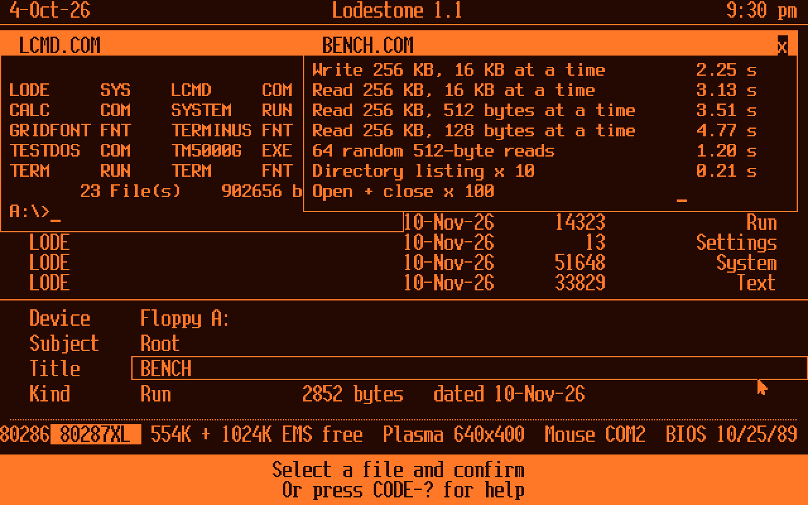
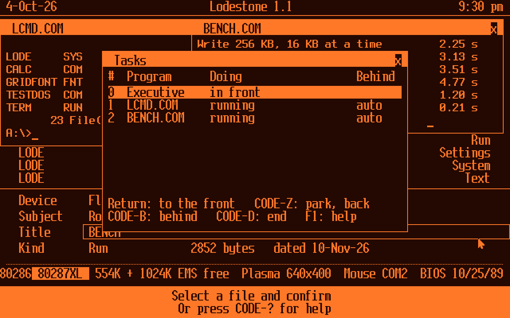
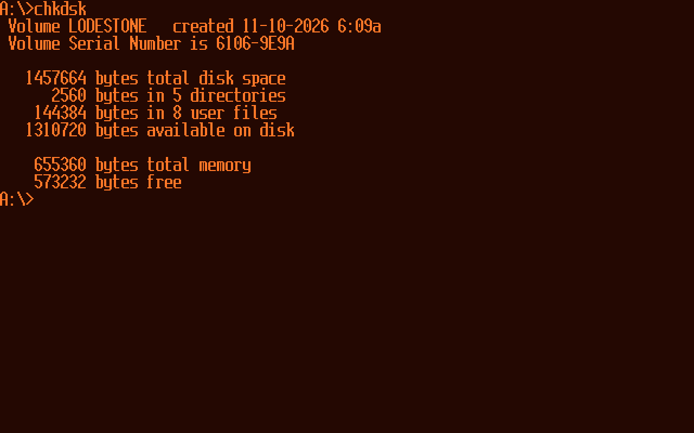
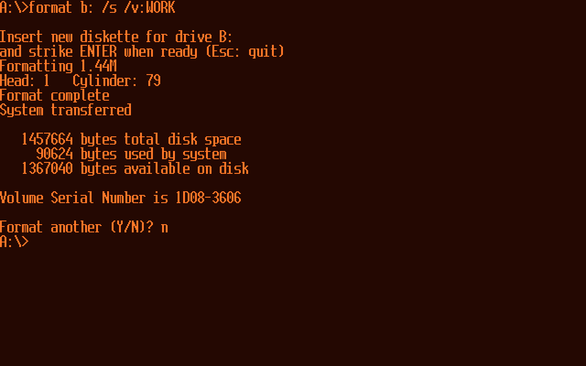
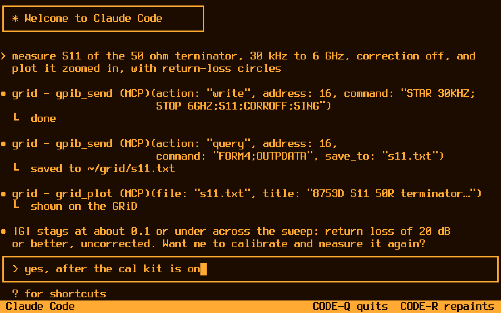
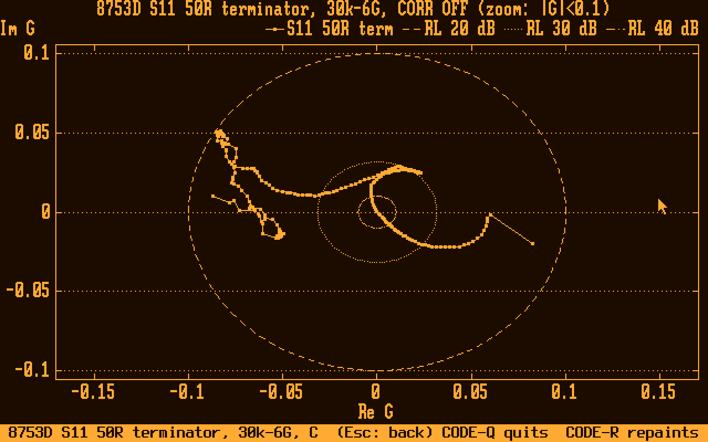
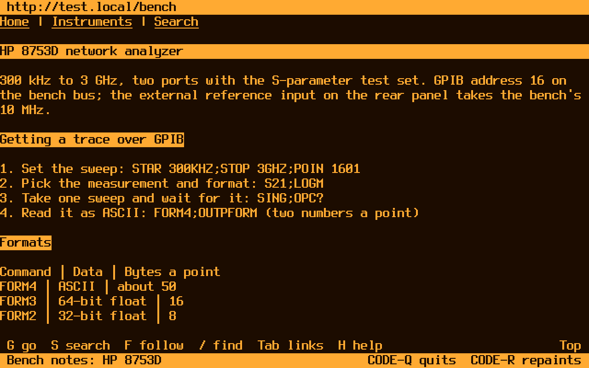
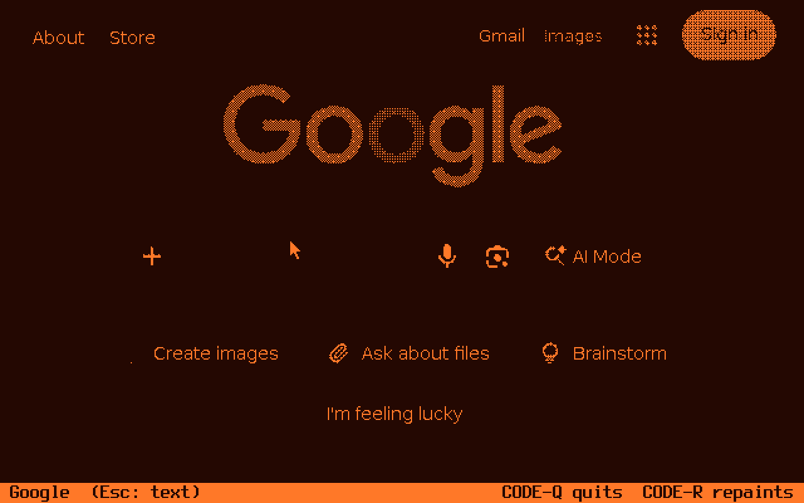

# Lodestone

A fast, DOS 3.30-compatible operating system for the GRiDCase 1520 (80C286, 640×400 gas-plasma display), with GRiD's own look and feel. The whole base suite fits in one 128 KB EPROM: the kernel, the Executive, the command prompt, System, Write, the calculator and the terminal window. A second EPROM adds DEFRAG, the disk utilities, Paint and Claude. It boots from that EPROM in the 1520's application-ROM socket, as GRiD MS-DOS did, or from a floppy. It runs the DOS programs of its day unchanged, more than three times faster on file work than GRiD MS-DOS, with more memory left for them. It can also multitask: several DOS programs run at once, preemptively, each full screen or in a window beside the Executive (`MULTITASK=1`).

Lodestone also connects the GRiD to Claude. Through a Raspberry Pi on the GPIB bus, Claude Code runs on the GRiD's screen and works with its files, its programs and the instruments on the bus.

| | |
|---|---|
|  |  |
| The start-up picture (`LODE.PIC`)¹ | System, Display: the font, and the start-up picture (Space turns it off) |
|  |  |
| The Executive: GRiD's File form (Device, Subject, Title); the status line shows the memory free for programs and in EMS, the panel as the 1520 reports it, and the serial mouse | Copy, Move and Delete take wildcards, with Replace and Only newer |
|  |  |
| Multitasking (`MULTITASK=1`): the command prompt and BENCH running as tasks, each in a window sized and placed over the Executive (CODE-F8, CODE-F7), which stays usable beside them | CODE-T: the tasks, with Return to bring one to the front, CODE-B to send it behind, CODE-Z to park it and CODE-D to end it |
|  |  |
| System: where the 640 KB goes, and the EMS | System: the floppy, the internal hard disk as C: (the 1520's own 121 MB Conner layout) and M:, the RAM disk |
|  |  |
| Write, a GRiDWrite-style editor | BENCH 1.4 on Lodestone with EMS |
|  |  |
| CHKDSK at the prompt, as DOS 3.30's (ROM 2's utilities) | FORMAT B: /S on a disk never formatted: each track verified, the system copied |
|  |  |
| The calculator over the Executive (CODE-K); the coprocessor lit in the info line (the emulator's is 387-class, so it reads as a 287XL) | `CALC` at the command prompt: sums, errors with ERRORLEVEL, `name=` for batch files |
|  |  |
| Claude Code on the GRiD (`CLAUDE /T`), measuring a terminator on an HP 8753D over GPIB | **On the real 1520:** an 8753D S11 trace plotted by Claude Code's `grid_plot`, saved with Shift-PrtSc |
|  |  |
| gridfox (`CLAUDE /W`): Firefox on the Pi, browsed from the GRiD as text | **On the real 1520:** gridfox's picture view, the page as Firefox draws it, in one bit (Esc goes back to text) |

*Screenshots from the emulator (`os/screens/readme_shots.py` and `claude-link/tests/readme_shots.py`), in the colours of the 1520's orange plasma (the captures from the real 1520 too). In the Claude Code and gridfox text shots the session is scripted, standing in for Claude Code and Firefox; the GRiD side and the link are the real ones. The plot and the picture view are captures from the real 1520.*

## What's in it

**The kernel** (`LODE.SYS`, about 48 KB)
- INT 21h for the programs of its day: COM and EXE loading, TSRs, INT 24h, INT 25h/26h, FAT12 and FAT16.
- A cylinder read-ahead cache for the floppies, kept in EMS when there is EMS.
- Its own LIM 4.0 EMS manager, when the 1520's memory is set to EMS.
- The GRIDGPIB driver API on INT 60h, built in, with a faster block transfer and SRQ on IRQ 5.
- An INT 33h driver for a serial mouse on COM1 or COM2.
- Screen capture and printing: Shift-PrtSc saves the screen as `SCREENnn.BMP` (graphics) or `SCREENnn.TXT` (text). PrtSc alone prints it through the printer driver chosen in System (or saves the file when none is chosen). A driver is a `.PRN` file of up to 1 KB that starts with a driver's signature, read from the disk only when PrtSc is pressed, so nothing of it stays in memory. Saving the file is a driver too, `SCREEN.PRN`, read from the root of the disk Lodestone started from (it is on the ROM). `PS.PRN` prints PostScript on LPT1 (a picture of a graphics screen, the text of a text screen); other printers are other drivers (`os/drivers/PS.ASM` says how to write one).

**Drives**
- **A:** and **B:**, the internal and external floppy drives.
- **C:**, any IDE drive or CompactFlash card with a FAT16 partition up to 2 GB (DOS's limit, with 32 KB clusters). Lodestone drives it through its own registers, because the 1520's BIOS only knows a few Conner models. Without a drive, nothing is loaded.
- **M:**, a RAM disk in EMS (256 KB by default, up to all the free EMS). It costs DOS programs no memory. Its files are gone at power-off, and at a restart on the 1520, whose BIOS rewrites EMS (a board that keeps EMS keeps them over a warm restart).
- **R:**, the ROM drive, when Lodestone's EPROM is fitted. It is read-only, and is mapped in only while a sector is read.

**The Executive and its programs.** These run on one shared UI core, in Lodefont, Lodestone's own 8×16 font (GRiD's system font and others load from `.FNT` files).
- **The Executive:** GRiD's File form (Device, Subject, Title). CODE-C copies, CODE-M moves, CODE-R renames and CODE-D deletes, with wildcards, Replace and Only newer, on files or whole subjects. A right click gives a menu of what applies. On a program that names its modes, such as CLAUDE.COM (Claude Code, Web browser, Chat, Load or Unload resident), the menu offers them too; with multitasking on, Web browser opens gridfox in a terminal window.
- **System:** memory, disks, clock, devices (and PrtSc's printer driver), GPIB, display, screen saver, the temporary disk M:, and where the settings come from.
- **Write:** a GRiDWrite-style text editor. A mouse drag selects text, and a right click gives a menu of its commands; Cut, Copy and Paste (CODE-Z, CODE-C, CODE-V) through a clipboard every program on the UI core shares.
- **The calculator** uses the 80287 or 287XL when one is fitted, and works with whole numbers when not. It runs as a window over the Executive (CODE-K) that you can drag by its title (or move with CODE-F7) and close with its x, and as `CALC` at the prompt, for batch files.
- **Paint** (`PAINT.RUN`): the picture is the whole 640 × 400 screen.
  - Tools: pencil, brush, eraser, line, box and filled box, with eight patterns and undo.
  - With multitasking on, it opens in a window that shows part of the picture at full size: the arrow keys or a drag on the window's frame move the view, and CODE-F switches to the whole screen and back.
  - Its pictures are Shift-PrtSc's 1-bit BMPs.
  - It is also the BMP viewer: Return on a `.BMP` in the Executive shows it. It shows any 1-bit BMP up to 640 × 400, centred, with dark paper.
  - It takes 63 KB while it runs and 32 bytes when it doesn't. See `docs/lodestone-paint.md`.
- **The screen saver:** runs DEFRAG on every disk in turn, then darkens the screen. It comes on inside CLAUDE.COM too (full screen, with the Pico bridge), and anything from Claude Code ends it.
- **A start-up picture**¹, drawn from vectors (`LODE.PIC`, 2.5 KB).

**Multitasking** (`MULTITASK=1` in LODE.INI; see `docs/lodestone-multitasking.md`)
- **How it works:** ordinary DOS programs multitask preemptively, in the 286's real mode, much as under DESQview.
  - **Turns:** each task gets a turn of timer ticks (two in front, one behind, at 18.2 a second) and is switched at the next safe point. That's never inside DOS itself, in the BIOS's ROM, or with interrupts off. One task at a time is inside DOS.
  - **Saved at every switch:** each task's registers, screen, keys, mouse, interrupt vectors and 80287 state.
  - **No protection:** tasks share one address space, so a program that goes wrong can still take down the machine. There's no virtual memory either.
- **Tasks:** Return on a DOS program in the Executive starts it as a task beside the others (Shift-Return runs it and waits, as before). CODE-Tab, or SysReq on its own, goes to the next task, and CODE-T shows the task list. SysReq is never put in the key buffer, so it takes nothing from the program in front; CODE-SysReq (Confm) stays the program's. (`KFLAGS=-dNOSYSREQ` builds without it, for a machine without the key, at no cost.) Each task has its own screen, keys and mouse. `BG=`, `FREEZE=`, `MTMEM=` and `FULL=` in LODE.INI set how particular programs run.
- **Windows:** Write, the calculator and Paint each open in a window over the Executive, several at once. The Executive stays live under them: a click on it or CODE-F6 brings it to the front.
- **Terminal windows:** a text program started from the Executive, and CODE-P's command prompt, run in a window of their own (Shift-Return and Shift-CODE-P: full screen, as before).
  - A window's memory grows as its program asks for more, when there is room. A program that switches to a graphics mode goes full screen until it comes back to text.
  - Text is selected with the mouse, copied (CODE-C) and pasted in as keys (CODE-V), with a right-click menu as in Write. A program in the window that uses the mouse gets its clicks there.
  - A program can publish its own screen and font for its window to draw, and can ask to run as soon as the GPIB bridge's SRQ arrives.
  - CLAUDE.COM runs in one (CODE-A), with the link about as fast as full screen.
- **Disk waits:** tasks behind keep running while one waits on the floppy (its motor's spin-up, a seek, a sector) or on the hard disk (a seek, the disk's turn, a write's end).

**The command prompt** (`LCMD.COM`)
- DOS 3.30's commands, with redirection and pipes (their files in %TEMP%, else %TMP%, else the current drive's root), and `&&` and `||`.
- Line editing, history and Tab completion.
- A batch language: IF, GOTO, FOR, CALL, SHIFT, CHOICE and `%NAME%`.
- Every built-in that can fail sets ERRORLEVEL, so scripts can check each step. Claude writes scripts too.

**Tools**
- **`FORMAT`:** formats a floppy in A: or B:, as DOS 3.30's FORMAT: 1.44 MB or 720 KB in the 1520's drive (360 KB and 1.2 MB in a 5¼-inch one), each track verified and bad sectors fenced off. `/S` makes it start Lodestone (the system read before the new disk goes in, so it works with one drive), `/V` gives it a label, `/Q` is a quick format of a disk formatted before. Every floppy gets Lodestone's boot sector. `FORMAT C:` formats the hard disk after MS-DOS's warning: the partition C: is on keeps its layout, so the kernel goes on using it at once; a disk the kernel found no file system on (a new CompactFlash card, a damaged boot sector) gets a new FAT16 layout in its first FAT16 partition, then a restart. The whole disk is read before anything is written, and Esc there leaves it as it was. It is on ROM 2.
- **`CHKDSK`:** checks a disk's file system as DOS 3.30's CHKDSK: A:, B:, C: or M:. Every chain is followed from its directory entry: cross links, chains into free or impossible clusters, loops, sizes that don't match, a subdirectory's `.` and `..`, the two FATs, lost clusters. `/F` writes the corrections (lost chains become `FILE0000.CHK`, ...; not on M:), `/V` lists the files. ERRORLEVEL 0 clean, 1 errors found, 2 couldn't check.
- **`FDISK`:** the hard disk's partition table, as DOS 3.30's FDISK: the DOS partition made (the kind C: takes, 3 MB to 2 GB, to whole cylinders), set active, deleted; other systems' left alone. `FDISK /STATUS` shows it and `/PRI[:MB]` makes it without questions, for scripts. A change under the kernel's C: restarts Lodestone. A new disk: FDISK, FORMAT C:, restart.
- **`SYS`:** makes a floppy with files on it start Lodestone: the boot sector, and the system from the start-up drive (R: from the ROM) or the one named, read first so one drive will do. Each file goes on under another name before the old one goes, so a failed write leaves the old system; the room is worked out before anything is written.
- **`LABEL`:** shows and sets a disk's volume label (A:, B:, C:), in the root and in the boot sector's DOS 4 BPB; Enter alone offers to delete it.
- **`DISKCOPY` and `DISKCOMP`:** copy and compare floppies track for track, as DOS 3.30's: two drives, or one with the disks swapped as asked (and the wrong disk put back in said). A target that isn't of the source's layout is formatted as it is written; the copy gets a new serial number (DOS 4's), so the kernel knows it for another disk. Unreadable source sectors are said and the copy goes on; `/V` reads each track back.
- **`ATTRIB`**, **`XCOPY`**, **`TREE`:** DOS 3.30's, at the prompt and in batch files, beside the Executive's File form.
  - `ATTRIB [+R|-R] [+A|-A] [+H|-H] [+S|-S] [name] [/S]` lists or sets attributes (hidden and system as DOS 5's: a hidden or system file is changed only by a command that changes H or S), never on directories or the label.
  - `XCOPY source [destination] [/A /M /D:date /P /S /E /V /W]` reads as many files as fit in memory, then writes them; directories are made as needed. Each copy is made as a new file and takes its name only when all of it is there, as the Executive's Copy, so a full disk leaves the old destination as it was. `/V` reads each copy back. Paths are compared as the kernel reads them (8.3 parts), so no other spelling copies a file onto itself or a tree into itself.
  - `TREE [d:] [/F]` lists the directories (and files), as DOS 3.30's.
- **`FIND`, `MORE`, `SORT` and `COMP`:** DOS 3.30's filters and file compare. FIND (`/V /C /N`, files or its input), MORE (a screen at a time: its input or a file), SORT (`/R /+n`, 63 KB), COMP (byte for byte, wildcards, a directory or drive as the second name). Each sets ERRORLEVEL.
- **`DEFRAG`:** defragments a floppy or C:. A power cut during any of its writes leaves the old file or the new one, never a damaged one. `DEFRAG /T` tests every free sector and fences off bad ones.
- **`HDPROBE` and `HDSCAN`:** diagnose an internal hard disk read-only, and can free a sticky Conner. They drive the disk themselves, so with multitasking on they run only with no other task there.
- **The rest:** BENCH, GRIDPROBE and others are in `tools/` and `os/bench/`.

**Settings** are kept in `LODE.INI`: the font, the screen saver, the start-up picture, M:'s size, PrtSc's printer driver, and `TEMP=` (the environment's TEMP: where CLAUDE.COM's captured output and the command prompt's pipe files go; `M:\` from the ROM without a hard disk). From the ROM, the ROM's own `LODE.INI` gives the defaults, and changes go in `C:\LODE.INI` (A: without a hard disk).

## Claude on the GRiD

`claude-link` runs on a Raspberry Pi connected to the GPIB bus through a bridge: a Pico 2 board with its own firmware, or an AR488 Nano. On the GRiD, `CLAUDE.COM` gives several ways in:

- **Term (`CLAUDE /T`, or CODE-A in the Executive):** the GRiD is the screen and keyboard of the real Claude Code, running on the Pi on your own Claude plan. Only the screen cells that change cross the link. Claude Code's tools reach the GRiD's files, DOS programs, screen and GPIB instruments through an MCP server on the Pi. Instrument writes and file changes are confirmed on the GRiD. With multitasking on (`MULTITASK=1`), CODE-A opens it in a terminal window beside the Executive, a picture going full screen and back (Shift-CODE-A: full screen, as before).
- **Resident (`CLAUDE /R`):** Claude stays in memory (1 KB of conventional memory, the rest in EMS). CODE-\ pops Claude Code up over a running program such as TM5000G, and back again. In the pop-up, Claude Code can read the program's screen, type into it, and use the GRiD's files and GPIB instruments. Back in the program, Claude goes on with files and instruments in the background, between the program's key calls, and can read the program's screen as it changes, without touching it (with the Pico 2 bridge's firmware of 2026-10-24).
- **Pictures and plots:** Claude Code can draw plots and pictures on the GRiD's screen in its font, such as an instrument trace fetched over GPIB.
- **gridfox (`CLAUDE /W`):** Firefox on the Pi, shown on the GRiD as text, with the mouse, and with pictures in a 1-bit view. A page's links, buttons, dropdowns, checkboxes, radio buttons, menus, tabs and players' controls work from the mouse in either view. In a terminal window it is 78 columns wide.
- **Chat (`CLAUDE`):** gridlink's own agent, on an API key, for a Pi too small for Claude Code.

Through the Pico 2 bridge the link moves 109 KB/s to the GRiD and 91 KB/s from it, with 6 ms round trips, and an idle GRiD answers within 8 ms. In serial terms that's over a million baud (8N1) into the GRiD and about 930,000 out of it: eight to ten times the 1520's own 115,200-baud port. It's 16 to 20 times a 56k modem and 7 to 9 times two-channel ISDN, roughly an early-2000s DSL line, with more speed out of the GRiD than most DSL lines of the day had upstream. See `claude-link/README.md`, `docs/term.md`, `docs/lodestone-resident-claude.md`, `docs/lodestone-pictures.md` and `docs/gridfox.md`.

## Speed and memory

BENCH 1.4, a file-system benchmark, on the real 1520 from its 1.44 MB floppy: **Lodestone 83–91 s, GRiD MS-DOS 3.30 289 s.** Small reads make most of the difference. Lodestone reads a cylinder ahead, while GRiD MS-DOS waits a turn of the disk for each 512 bytes.

On the 1520, BENCH from each kind of drive, in seconds:

| Test | Floppy A: | Hard disk C: (Conner CP30104H) | RAM disk M: |
|---|---:|---:|---:|
| Write 256 KB, 16 KB writes | 12.52 | 0.87 | **0.16** |
| Read 256 KB, 512-byte reads | 9.61 | 0.71 | **0.27** |
| 20 small files, create + delete | 22.63 | 3.57 | **0.10** |
| Load + run a 120 KB .EXE ×3 | 12.74 | 0.65 | **0.16** |
| **All ten tests** | **87.6** | **9.1** | **2.1** |

Lodestone as on main (2026-11-03, `os/bench/compare3.py`; multitasking off; its memory figures 2026-11-09, with INT 21h F008h for a floppy its program wrote itself (given the sector as read and as written), a floppy's FAT written only after a look at its drive, a floppy's root's first sector part of what makes it the same disk, a disk changed under a transfer asked about there and then, a floppy's mount rules, the Executive's right-click menu, a program's modes on it, and MS-DOS's FCB search, names and CHDIR) against GRiD MS-DOS 3.30 and FreeDOS (kernel 2046 with FreeCOM), all in the emulator with the 1520's drive timing and 1408 KB of EMS. Times are in seconds; lower is better.

| | Lodestone | GRiD MS-DOS 3.30 | FreeDOS |
|---|---:|---:|---:|
| BENCH file-system total | **78.6** | 285.4 | 283.2 |
| EMS: map a page ×10,000 | **0.35** | 2.87 | 2.87 |
| Memory for programs, with EMS | **578.3 KB** | 573.1 KB | 494.2 KB |
| Memory for programs, no EMS | 562.2 KB | **580.4 KB** | 501.5 KB |

**Memory:**
- **With EMS:** Lodestone keeps its 18 KB disk cache in EMS, so a DOS program gets more memory than under GRiD MS-DOS with `EMM.SYS`. That holds even though the Executive, the EMS manager and the cache all stay resident.
- **Without EMS:** the cache stays in conventional memory, so GRiD MS-DOS leaves programs about 16 KB more.
- **With multitasking on** (`MULTITASK=1`, which needs EMS): a program run in the Executive's own task (Shift-Return) gets 554.0 KB (554.2 before a Fail nobody was asked for was kept apart from the user's, the look at a floppy whose FAT is to go was asked as a write, a directory wasn't taken for the root when its disk can't be read, and a task's 0Fh prompt said "Invalid disk change"; 554.4 before INT 21h F008h checked what its program read and a floppy's FAT was written from another drive's call only after a look at its drive; 554.6 before a floppy's root's first sector was part of what makes it the same disk; 555.0 before a disk changed under a transfer was asked about there and then, each task's directories went with their mount and the 2-second rule for a drive without a change line; 555.6 before a floppy's mount rules: a file's mount number, "Invalid disk change" while files are open, the current directory found again by name; 556.1 before a failed write's rules and "Invalid disk change"; 556.6 before MS-DOS's FCB search, names and CHDIR; 557.5 before the Executive's right-click menu and a program's modes on it). The other 24.2 KB is the multitasker's resident code, task 0's saved state, its tables and a stack. A program started as a task with Return gets its `MTMEM=` size, or 64 KB for a .COM and its header's size for an .EXE; START gives 64 KB or its `/M:` size. Either can grow when there is free memory below it.
- **Hard disk and ROM:** C: costs about 3 KB when a drive is there. R: costs 0.4 KB when ROM 1 is there, 0.6 KB with ROM 2 as well.
- **The Executive stays resident on purpose:** with multitasking on, it runs beside the tasks and windows.

The full tables, the method and every run on the 1520 are in `os/bench/RESULTS.TXT`, `RESULTS3.TXT` and `RESULTS_HD.TXT`, and the `BENCH_1520_*.TXT` logs.

## Installing on the GRiD

### From an EPROM

`os/build.sh` builds ROM 1, a 128 KB GRiD application ROM (a FAT12 volume in GRiD's own format). It holds the kernel, the command prompt, System, Write, the calculator, the terminal window (TERM.RUN) and the default settings. ROM 2 (`os/LODE2_EPROM.BIN`, a data ROM in the other socket) holds DEFRAG, the disk utilities (FORMAT, CHKDSK, FDISK, SYS, LABEL, DISKCOPY, DISKCOMP), ATTRIB, XCOPY, TREE, FIND, MORE, SORT and COMP, the terminal window's font, Paint, CLAUDE.COM and the two other screen fonts (GRiD's and Terminus); its files show in R: beside ROM 1's.

1. Burn **`os/LODE1_EPROM.BIN`** to a 27C010 (the 1520's original part is a TMS27C010A). Don't burn `LODE1.BIN`: the 1520 inverts address line A16 to its ROM sockets, so the file to burn has its two halves swapped. The two have the same programmer checksum, so check the bytes: address 10000h starts `EB 3C 90` then `LODE ROM`.
2. Fit it in the **second** socket, where GRiD MS-DOS's EPROM sits. The BIOS boots the last bootable ROM it finds. GRiD MS-DOS can move to the first socket, if ROM 2 isn't there.
3. Burn **`os/LODE2_EPROM.BIN`** (ROM 2: DEFRAG.COM, FORMAT.COM, CHKDSK.COM, FDISK.COM, SYS.COM, LABEL.COM, DISKCOPY.COM, DISKCOMP.COM, ATTRIB.COM, XCOPY.COM, TREE.COM, FIND.COM, MORE.COM, SORT.COM, COMP.COM, TERM.FNT, PAINT.RUN, CLAUDE.COM) the same way and fit it in the **first** socket: a data ROM is never booted. GRiD MS-DOS then has no socket. Without ROM 2 everything works but DEFRAG, the disk utilities, terminal windows, Paint and Claude: the screen saver shows only the dark clock, text programs start full screen, Return on a `.BMP` says PAINT.RUN is not on this disk, and CLAUDE.COM and the disk utilities must be copied to `C:\LODE` (with no hard disk, run them from A:). **Burn both ROMs from one build** (`docs/lodestone-rom.md`, "Re-burning for O10"): a new ROM 1 doesn't join an older ROM 2 (`L2`, as 0.6's images), so it would lose DEFRAG, TERM.FNT, Paint and CLAUDE.COM.
4. Hold **Shift** while the 1520 starts for the boot menu: Lodestone, Lodestone with the ROM's own settings, GRiD MS-DOS (from the other socket, without ROM 2), or the floppy.

From the ROM, the current drive is C: (R: without a hard disk), and `PATH` is `C:\LODE;R:\`. So a newer program copied to `C:\LODE` is used before the ROM's copy, and an update needs no new ROM. CLAUDE.COM is on ROM 2: a newer CLAUDE.COM in `C:\LODE` is used before it. See `docs/lodestone-rom.md`.

### From a floppy

1. Format a 1.44 MB floppy and copy `LODE.SYS`, `LODEMT.SYS`, `LODE.PIC`, `LCMD.COM`, `DEFRAG.COM`, `SYSTEM.RUN`, `WRITE.RUN`, `CALC.RUN`, `TASKS.RUN`, `CALC.COM`, `PAINT.RUN`, `SCREEN.PRN` (Shift-PrtSc's file writer), `TERM.RUN` and `TERM.FNT` (the terminal window, with `MULTITASK=1`: without them text programs start full screen) and whatever programs you want. The current release's files are in `os/releases/`.
2. Under GRiD MS-DOS, run `LODEBOOT` on it once (`B:LODEBOOT B` when booted from the EPROM, where the floppy is B:).
3. Restart and tap **F** as the memory count finishes, or choose the floppy from Lodestone's boot menu.
4. Once Lodestone runs, `FORMAT B: /S` (or `A:`) makes another start-up floppy in one step: format, boot sector and the system files; copy the programs after.
5. A new `LODE.SYS` can simply be copied over the old one. Copy `LODEMT.SYS` from the same build with it: multitasking (`MULTITASK=1`) reads it at start-up and stays off if it doesn't match.

See `docs/lodestone-floppy-dev.md`.

## What's here

| Folder | What |
|---|---|
| `os/src` | The OS, in NASM: the boot sector (`BOOT.ASM`), the ROM's boot sector (`ROMBOOT.ASM`), `KROM.INC` (R:, the ROM drive, and booting from the ROM), `LODEBOOT.COM` (installs it), the kernel (`LODE.ASM` + `K*.INC`: `KEMS.INC` the EMS manager, `KHD.INC` the hard disk, `KMDISK.INC` the RAM disk M:, `KGPIB.INC` GPIB, `KSPLASH.INC` the start-up picture's bootstrap), `SPLASH.ASM` (`LODE.PIC`, the picture), the UI core (`UICORE.INC`, its API in `UIAPI.INC`) and the Executive (`EXEC.INC`), the shell `LCMD.COM`, `FORMAT.COM`, `CHKDSK.COM`, `FDISK.COM`, `SYS.COM`, `LABEL.COM`, `DISKCOPY.COM` (and `DISKCOMP.COM`, the same source), `ATTRIB.COM`, `XCOPY.COM`, `TREE.COM`, `FIND.COM`, `MORE.COM`, `SORT.COM`, `COMP.COM`, `DEFRAG.COM`, `HEADCLN.COM` (drive head cleaning with a wet cleaning disk), `CALC.COM` (the calculator at the prompt; its engine `CALC.INC`, and `FPU.INC`, which coprocessor) |
| `os/splash` | The start-up picture's source: the source image, `trace.txt` (the stone's outline and the nails, editable), `trace.py` (how they were traced), `mksplash.py` (packs them into `src/SPLASH.INC` and draws the picture the tests compare the GRiD's screen with, bit for bit) |
| `os/rom` | `LODE.INI`, the settings burned into the ROM. The ROM images are `os/LODE1_EPROM.BIN` and `os/LODE2_EPROM.BIN` (to burn) and `os/LODE1.BIN` and `os/LODE2.BIN` (as the BIOS sees them), built by `os/build.sh` with `tools/mkrom.py` |
| `os/apps` | Programs on the UI core (`.RUN`, built with `os/mkrun.py`): `SYSTEM.RUN`, `WRITE.RUN`, `CALC.RUN` (the calculator's window), `TASKS.RUN` (the tasks, CODE-T), `PAINT.RUN` (Paint, and the BMP viewer) and `TERM.RUN` (a text program's terminal window, with `MULTITASK=1`) |
| `os/drivers` | Drivers for PrtSc (`.PRN`, up to 1 KB, read only when PrtSc is pressed): `PS.PRN`, PostScript on LPT1 (`PS.ASM` describes the interface); `SCREEN.PRN`, the screen saved as a file (Shift-PrtSc, and PrtSc with no printer chosen) |
| `os/fonts` | `LODEFONT.TXT`, the built-in font's glyphs (`os/lodefont.py` makes `src/FONT.INC` from it; `docs/lodestone-font.md`); `GRIDFONT.FNT` (GRiD's TC8X16) and `TERMINUS.FNT`, 8×16 fonts System can switch to; `TERM.FNT`, code page 437's 256 characters for the terminal window (from Terminus Bold, by `tools/mkfnt437.py`) |
| `os/tests` | `pcemu`-based tests (see Tests below), and the DOS programs they run: TESTDOS, CACHETST, CAPTEST, EMSTEST, HDABS, HDFLUSH, MDTEST, MEMSZ, TSR, UPPER, the M33 programs, UITEST.RUN; and for the 1520: CMDTEST.BAT (the batch language), CALCTEST.BAT (the calculator, step by step) and FPUPROBE.COM (what the coprocessor answers after FNINIT) |
| `os/bench` | BENCH.COM, DISKMAP.COM, `run_bench.py` (against GRiD MS-DOS), `compare3.py` (against GRiD MS-DOS and FreeDOS, with EMS; FreeDOS's files in `bench/freedos`), `run_bench_hd.py` (on C: and M:), profiling tools, `RESULTS.TXT`, `RESULTS3.TXT`, `RESULTS_HD.TXT` and the 1520 logs |
| `os/claude` | CLAUDE.COM, Claude for GRiD (the GRiD side of claude-link): chat, and Term (`TERMLINK.INC` the link, `TERMCELL.INC` the screen, `TERMKEYS.INC` the keys); resident Claude: `CLAUDE /R` (an INT 16h stub at the top of memory, its console `RCON.ASM` in EMS: Term's own code, Claude Code in the pop-up) and `CLAUDE /U`, with `M1TEST.BAT` for the 1520; `KEYCODE` (each key's INT 16h code, for the 1520); and the test programs `EMSUSE`, `GFXUSE`, `T1C`, `BUSY`, `MHAND`, `HOLE`, `HOOK16` and `PAGE1` |
| `os/diag` | CRASHLOG, a diagnostic build for a crash that restarts the 1520: a flight recorder in MT and a catch for the restart through the BIOS's shutdown code, `CRASHRPT.COM` (the report to `CRASH.BIN`) and `crashdecode.py`; its own `README.md` says how to use it |
| `os/releases` | Every release's files, 0.1 to 1.1 (0.6, 1.0 and 1.1 have the ROM images too) |
| `os/screens` | Emulator screenshots (`readme/` for this page, made by `readme_shots.py`) |
| `os/*.py` | `pcemu.py` (a BIOS-level PC in unicorn: INT 13h with real-drive timing, mode 40h, the 7210 GPIB chip, EMS, an IDE drive with optional seek and rotation timing), `ktest.py`, `mkimg.py`, `mkrun.py`, `psf.py`, `sim7210.py`, `lodefont.py` and `typfont.py` (build the fonts); `gosim.py` and `test_*.py` are the 0.1 harness |
| `claude-link` | `gridlink` on the Raspberry Pi: GRiD ↔ GPIB bridge (Pico 2 or AR488 Nano) ↔ Pi ↔ Claude (Term: the real Claude Code in a pty, with an MCP server for the GRiD's tools, plots and pictures; chat: the Claude API), `gridfox` (Firefox for the GRiD), the AR488 patch, and the tests |
| `tools` | 1520 tools: GRIDGPIB (GPIB driver for GRiD MS-DOS), GPIBSCAN, GPIBTEST, GGTEST, GRIDMEM (EMS or extended memory), EMSKEEP (does EMS keep its contents through Ctrl-Alt-Del? On the 1520: no), MEMPROBE, GRIDPROBE, RAMSPEED, ROMDUMP, HDPROBE and HDSCAN (the internal hard disk, read-only: diagnosis, and a read of every sector), FPUID (which 80287 is fitted, 80287 or 287XL, and whether its multi-word stores finish: a timer watchdog names a chip that hangs instead of locking up), MODEMID (which internal modem is on COM1: Option 330, 1200 baud, or Option 331, 2400; it asks AT at each speed and then ATI0-4, and never dials), SERLINK (the Claude link without the GPIB cartridge: over the internal modem or a serial cable; `docs/serial-link.md`), the C GPIB library, and TM5000G.EXE (a test fixture; its source lives in the TM5000 repo) |
| `rom` | Our notes on the 1520 BIOS (a symbol map), probe and scan logs, and the hard disk's partition and boot sectors |
| `docs` | Design notes: the kernel, the UI core and programs, DEFRAG and the saver, the start-up picture, the ROM, Term, resident Claude, pictures, gridfox, the serial and modem link (SERLINK), the floppy development loop |
## Build

Needs NASM 2.15+, and Python 3 for the `.RUN` programs (`mkrun.py`).

```sh
os/build.sh        # everything in os/src, apps, tests and bench, and LODE1.BIN (ROM 1)
os/kbuild.sh       # just the kernel, with LODE.MAP / .LST
cd os/claude && ./build.sh
```

The built binaries are committed too, so a fresh clone can go straight onto a floppy.

### A serial build, for a GRiD without the GPIB cartridge

The kernel and ROMs here are built with the built-in GPIB driver. A GRiD without the GPIB cartridge can instead
have a kernel with the serial link built in (`os/src/KSER.INC`, in place of `KGPIB.INC`):

```sh
KFLAGS=-dSERIAL os/build.sh     # LODE.SYS, LODEMT.SYS and LODE1_EPROM.BIN with the serial link
os/build.sh                     # back to the GPIB build (as committed)
```

- **Connection:** CLAUDE.COM reaches gridlink on the Pi (`--bridge serial --baud 19200`) over a null-modem cable on
  COM2, with no extra driver to load.
- **The setting:** `SERLINK=` in LODE.INI sets the port and speed: `SERLINK=COM2,19200` (the default),
  `SERLINK=COM2,38400`, `SERLINK=COM1,2400`, or `SERLINK=OFF`.
- **Size:** the serial kernel is 864 bytes smaller than the GPIB one, and its ROM 1 has 2,048 bytes free.
- **Pre-interrupt style:** the UART still receives on its interrupt, into a 2 KB ring, but CLAUDE polls the link
  rather than sleeping until an answer arrives, and multitasking's wake-on-SRQ isn't used.
- **Ports:**
  - The port is set up at CLAUDE's first call, after the start-up mouse probe, so a serial mouse and the link
    can't share COM2.
  - GPIBnn devices and Claude's instrument tools get "no listener".
- **Dialing:** the serial kernel doesn't dial. For the internal modem, set `SERLINK=OFF` and load `SERLINK /D:`
  (`tools/`) on top.

See `docs/serial-link.md`. `os/tests/test_serial_kernel.py` builds it and checks it.

## Tests (emulator)

The tests run Lodestone in `pcemu`, a BIOS-level PC emulator (unicorn) with the 1520's drive timing, display mode, 7210 GPIB chip, EMS, IDE drive and ROM sockets. They need Python 3, `unicorn` 2.x and mtools (and `pyte` for the four that run claude-link's terminal: test_claude_kernel, test_claude_mouse, test_claude_window, test_resident_term). All 3,333 checks pass (the 25 suites in `os/tests`); claude-link's own tests are in `claude-link/tests`.

```sh
cd os
python3 tests/test_kernel.py          # DOS calls, files, EXEC, the cache, EMS, capture, M:, the command prompt, CALC
python3 tests/test_apps.py            # the UI core, Executive, System, Write, the mouse, the calculator, Paint
python3 tests/test_rom.py             # the ROM image, booting from it against the real BIOS, R:, settings, the boot menu
python3 tests/test_splash.py          # the start-up picture, bit for bit on every start-up path
python3 tests/test_hd.py              # drive C:
python3 tests/test_defrag.py          # DEFRAG on floppies and C:, the screen saver's round
python3 tests/test_claude_kernel.py   # Claude-link scenarios on the kernel
python3 tests/test_claude_mouse.py    # the mouse in Claude's views
python3 tests/test_resident.py        # resident Claude: CLAUDE /R and /U, over other programs
python3 tests/test_resident_term.py   # resident Claude's console, with gridlink and a stand-in Claude Code
python3 tests/test_mt.py              # multitasking (MULTITASK=1), and nothing of it with the switch off
python3 tests/test_hdprobe.py         # HDPROBE
python3 tests/test_hdscan.py          # HDSCAN
python3 tests/test_headcln.py         # HEADCLN
python3 tests/test_format.py          # FORMAT: floppy sizes, bad sectors, /Q, /S, C: both ways, the kernel seeing the new disk
python3 tests/test_chkdsk.py          # CHKDSK: damaged disks found and put right, floppies, C:, M:
python3 tests/test_fdisk.py           # FDISK: the partition made, set active, deleted; a new disk to C:
python3 tests/test_sys.py             # SYS: a floppy's files kept, the system and boot sector put on
python3 tests/test_label.py           # LABEL: floppies and C:, the kernel seeing the new label
python3 tests/test_diskcopy.py        # DISKCOPY and DISKCOMP: two drives, one with swaps, formatting, bad sectors
python3 tests/test_filetools.py       # ATTRIB, XCOPY, TREE: switches, trees, a full disk, a file bigger than memory, paths as the kernel reads them, a terminal window
python3 tests/test_filters.py         # FIND, MORE, SORT, COMP
python3 tests/test_modemid.py         # MODEMID, against no modem, Option 330 and Option 331
python3 tests/test_serial_kernel.py   # the -dSERIAL kernel: its link driver, SERLINK=, the GPIB build untouched
python3 tests/defrag_cut.py 2         # a power cut at every DEFRAG write (~20 min; "2 hd" for C:)
python3 bench/run_bench.py <GRiD MS-DOS EPROM image>
```

Some checks need the GRiD MS-DOS EPROM image (`GRID_ROM=…`, or `rom/GRID_MSDOS330_ROM_300909-00.BIN`), and the 1520's BIOS (`rom/ROM_F000.BIN`, with `rom/CMOS128.BIN`). Without them, those checks are skipped.

## Status and what's next

**Lodestone 1.1** is the current release. It boots from an EPROM on the 1520, and from a floppy. On the 1520:
- the kernel, the Executive and its programs, EMS, C:, M: and the calculator on a real 80287 all work;
- Claude Code works through the Pico 2 bridge, including gridfox, pictures and plots;
- resident Claude works over a running program, including fetching and plotting an instrument trace.

Release notes are in `os/releases/`, and each part's design and history is in `docs/`.

Multitasking works on the 1520, tasks running from its hard disk included, and so do Paint in a window and resident Claude reading the program's screen in the background (CLAUDE 1.11) and drawing the mascot in its console (1.12). Pipes from the ROM work there too, with a hard disk. Built since 0.6 and not yet tried there: the ROM's `TEMP=M:\` (which applies only without a hard disk), SysReq as the task switcher, FORMAT, CHKDSK, FDISK, SYS, LABEL, DISKCOPY, DISKCOMP, ATTRIB, XCOPY and TREE.

**Next:**
- **On the 1520:** the list above tried on the machine, and what it finds fixed.
- **GRIDMODE.COM:** the BIOS's display functions (INT 15h E420h-E422h) from the prompt, as GRiD's MS-DOS `MODE` gave them: the panel type, the internal panel or the external RGB port, the colour map (how CGA colours become plasma or LCD greys, at 40:A7h) and the hardware text font. A tool beside GRIDMEM, not in ROM 1; SYSTEM to show the panel type too.
- **Voice on the Pi:** push-to-talk and spoken answers.
- **Native bench programs:** a plot view in the UI core, and an instrument app driven by profiles (scopes, a VNA). Programs that share the screen.
- **The FreeDOS kernel calls:** INT 21h 60h/6Ch and IOCTL 440Dh, so FreeDOS's LABEL, XCOPY and the like run.

Third-party material in the repo (the Terminus font, FreeDOS for the benchmark, the AR488 patch, the bridge firmware's libraries, TM5000G) and its licenses: [`THIRD_PARTY.md`](THIRD_PARTY.md).

> **Name:** Lodestone was called Grid-OS up to 0.4.0. Since 0.4.1 the kernel is `LODE.SYS` (settings in `LODE.INI`), the shell `LCMD.COM` and the boot installer `LODEBOOT.COM`; they were `GRIDOS.SYS`, `GRIDOS.INI`, `GRIDCMD.COM` and `GOSBOOT.COM`. Release notes up to 0.4.0 keep the old names.

---
¹ A drawing based on a public-domain illustration, Fig. 1 of F. A. Annett's *Electrical Machinery* (1921).
