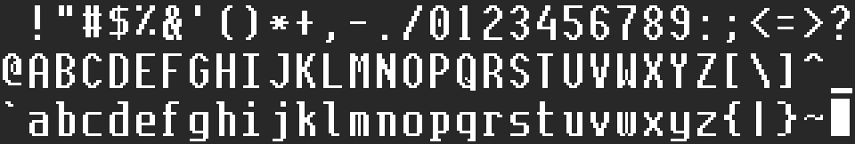

# Lodefont

Lodefont is Lodestone's own screen font: 8×16 cells, codes 32–127 (127 is the solid block). It is built into the UI core (LODE.SYS), System (to switch back to) and DEFRAG, and is the font everything on the UI core draws with unless `FONT=` in `LODE.INI` names another.

## The design

An original pixel font, drawn glyph by glyph for the 8×16 cell. Like most new type it borrows a general feel, here from science-fiction screen lettering and early geometric slab-serif typefaces, but no glyph is copied or traced from another font.

- **Capitals and digits:** tall rectangles with rounded corners and straight sides, an M whose middle comes down in a V, an open 4.
- **N:** the diagonal two pixels wide, stepping every two rows, high in the letter.
- **Lowercase:** square bowls and small slab serifs on i, j, l, n, r, h, k and f.
- **Strokes:** uprights two pixels wide, crossbars one, so the 1520's plasma shows them and the letters stay open.
- **Telling characters apart:** the zero has a dot, I has slabs at both ends, l a tail, 1 a flag and a foot, and | is a plain bar.

## Metrics

| Rows | What |
|---|---|
| 0 | empty: the gap between lines |
| 1–13 | capitals, digits, ascenders (13 rows) |
| 5–13 | the x-height |
| 14–15 | descenders (g j p q y; the comma's tail; `_`, two rows thick as GRiD's, so the tests' screen reader doesn't take the UI's one-pixel rules for it) |

Column 7 is the gap between characters. The baseline and x-height are GRiD's TC8X16's, so screens laid out for GRiD's font lay out the same. GRiD's capitals start on row 0; Lodefont's start on row 1, which leaves a line of space between text lines.

## The files

| File | What |
|---|---|
| `os/fonts/LODEFONT.TXT` | the source: each glyph a line with its code and character, then 16 rows of `#` (lit) and `.` (dark) |
| `os/lodefont.py` | makes `os/src/FONT.INC` from it (the layout `typfont.py` writes and `pcemu.load_font` reads); `--fnt NAME.FNT` makes a font file, `--sheet NAME.PNG` a picture of the glyphs |
| `os/src/FONT.INC` | generated: the built-in font. Run `lodefont.py` after changing `LODEFONT.TXT`, then `build.sh` |
| `os/fonts/GRIDFONT.INC`, `GRIDFONT.ASM` | GRiD's InteGRiD system font TC8X16 (the font Lodestone had from 2026-10-06), built as `GRIDFONT.FNT` |

## The other fonts

`GRIDFONT.FNT` (GRiD's) and `TERMINUS.FNT` are on ROM 2, which joins R:, so started from the ROM, System's Display lists them and Return switches to them; without ROM 2 there is only Lodefont. On a floppy they work from the root of the start-up disk, as any font file does: exactly 1,536 bytes. Display lists only files of that size (the terminal window's 4 KB `TERM.FNT` isn't one).

The screen reader in the tests (`ktest.font()`) knows Lodefont, GRiD's font and Terminus; no glyph of one is another character's in the others.

Not in Lodefont yet: CLAUDE.COM's console still draws in Terminus (its own glyphs from 80h were drawn to match it), and the pictures the Pi draws (`claude-link/gridlink/gridfont.py`) still use GRiD's glyphs.
