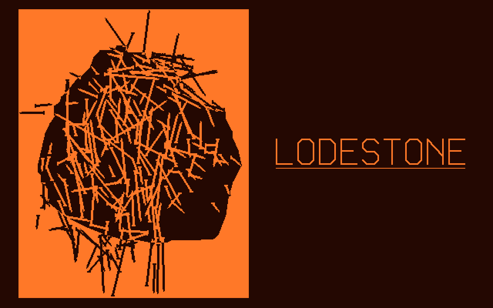

# Lodestone 0.4.3 — the start-up picture (2026-10-09)

At start-up Lodestone shows Fig. 1 of F. A. Annett, *Electrical Machinery* (McGraw-Hill, 1921), "Lodestone attracting some iron nails" (public domain), redrawn from vectors, with LODESTONE underlined beside it. It stays 2 seconds or until a key.

## Design decisions

- **Monochrome:** 1 bit, lit or not, as mode 40h is anyway; no grey palette tricks.
- **The plate as printed:** lit paper, a dark stone. Each nail is lit where it lies on the stone and dark where it crosses the paper. A dark-screen version (a lit stone with dark nails knocked out of it) was tried and read as a blob.
- **Only the title**, LODESTONE underlined. The version and caption lines of the first draft are gone. Since 2026-11-05 its letters are Lodefont's capitals as thin strokes (`lodestone-font.md`): O and D tall with cut corners, N's diagonal ending high. They were chamfered 1920s drawing capitals before.
- **Its own file:** the picture is `LODE.PIC`. The kernel keeps only a small bootstrap that reads it into memory, runs it and lets the memory go. In the first version the picture was part of `LODE.SYS`'s start-up code. That was already non-resident, but it made `LODE.SYS` 2.7 KB bigger on disk.
- **Off from the Executive's side:** System, Display, Space writes `SPLASH=0` to `LODE.INI`, and the bootstrap then never opens `LODE.PIC`. With no `LODE.PIC` on the disk there is no picture either.
- **Standing rule:** minimal resident bytes, reuse, speed. The picture costs 0 resident bytes, and DOS programs get 562.5 / 578.6 KB, as under 0.4.2.

## Files

| File | What |
|---|---|
| `os/splash/plate.png` | The plate, 532 × 668, from the Wikimedia Commons scan |
| `os/splash/trace.py` | How `trace.txt` was traced (OpenCV, scikit-image; not part of the build) |
| `os/splash/trace.txt` | The drawing in plate pixels: the stone's outline (`R x y`, 69 points) and the nails (`N hx hy tx ty`, head then point, 235). Edit freely. |
| `os/splash/mksplash.py` | Scales it by 9/16 to the screen, packs it into `src/SPLASH.INC`, and draws it in Python exactly as the 286 does (`splash.png`, and the tests' reference) |
| `os/src/SPLASH.ASM` | → `LODE.PIC` (2,544 bytes): the drawing code and `SPLASH.INC` |
| `os/src/KSPLASH.INC` | The bootstrap, in section boot of `LODE.SYS` (336 bytes on disk, never resident) |
| `os/apps/SYSTEM.ASM` | Display: "Start-up picture yes/no"; Space |
| `os/tests/test_splash.py` | 62 checks |

## Tracing (trace.py)

1. **The stone:** the plate is blurred, thresholded (Otsu), opened to drop the nails and closed; the biggest blob is kept. Its bottom is cut along a hand-placed curve, because the hanging bundles of nails would otherwise count as stone. The outline is then simplified to within 2 pixels.
2. **The nails as ridges:** CLAHE, then Sato's ridge filter, bright ridges on the stone and dark ones on the paper. The two are blended across the stone's edge so the edge itself isn't a ridge.
3. **Lines:** a 25-pixel line integral of the ridge map at 45 angles. Its peaks, and at crossings every strong angle, seed lines. Each seed is refitted to its ridge's centre and extended along it over short gaps.
   - A line is kept only if enough of it is ridge that the lines already kept don't explain. That stops fans of near-duplicates through crossings.
   - Repeats of a kept line and lines running along the stone's edge are dropped.
   - A gentler second pass then fills in, for 235 nails in all.
4. **Heads:** the wider end of the ridge is the head. If neither end is clearly wider, the end nearer the middle of the stone is, since nails stick out from it point first, as in the plate.

## The drawing (SPLASH.ASM, mksplash.py)

- **Packing:**
  - Each nail is 4 bytes, sorted by head row: x low byte | x bit 8 (bit 7) + rows down from the previous head (bits 0–6) | the point's dx | dy (signed bytes, ±127).
  - The outline is its first vertex as words, then a signed-byte step to each next one.
  - The title is per-letter strokes on a 20 × 32 grid, Lodefont's capitals drawn thin.
- **The stone:** each outline edge that isn't level marks its rows y0 ≤ y < y1 at x = x0 + (x1 − x0)(y − y0)/(y1 − y0), by IMUL/IDIV, which truncates. Each row keeps its least x and its greatest x + 1, and the plate is filled row by row around that span.
- **Nails:** Bresenham from the head. The shank is 3 pixels wide across the minor axis, narrowing to 2 and then 1 over the last three points, with a head 5 across and 2 deep.
  - **The pixel (NPIX) has no branches:** whether it is on the stone is two compares turned into a mask (`CMP/CMC/SBB`, `CMP/SBB`, `AND`), then one read and one write of the screen byte.
  - **The line loop never asks which way the line runs:** the major step, minor step and the step across are vectors set up first.
  - The first version, with a call and four branches per pixel, took 1.47 s in pcemu's 286 model; this one takes 252 ms.
- **Python must match it bit for bit:** `mksplash.render` uses the same integer rules, and the tests compare all 256,000 pixels of the emulator's screen with it. mksplash also checks that no point falls off the screen, since the 286 code doesn't clip.

## Start-up (KSPLASH.INC)

- **Getting control:** `hd_init`'s last jump goes to `sp_hook`, which makes `init` end through the far jump at KSEG:0000 (KMDISK's way).
  - If `ems_init` already put a jump to `md_boot` there, `sp_hook` takes that over and goes on to `md_boot` afterwards.
  - Otherwise (no EMS, or the `-dNOTC` build) it saves `start`'s 5 bytes there itself and puts them back afterwards.
- **`sp_boot`** runs on the UI's stack, as `md_boot` does:
  - It reads up to 4 KB of `\LODE.INI` into 1000:F000, md_boot's buffer, which md_boot reads after it. `SPLASH=0`, `No` or `Off` (any case, at a line's start) means no picture.
  - It reads `\LODE.PIC` into 2000:0000, free at that point: the load image ends near 1000:B300, and a UI block reaching that far would have overwritten this code first.
  - The file must start with `EB 0A "LODEPIC" 01`, and the word at offset 10 must equal the number of bytes read. A cut-short or padded copy is never run.
  - It then far-calls 2000:0000 and goes on to `md_boot` or `run_ui`. The Executive's mode set clears the screen.
- **LODE.PIC itself:**
  - It sets mode 40h, or does nothing if the BIOS doesn't give it, and draws.
  - It drops keys already typed, such as spare F taps from choosing the floppy at the BIOS's prompt, which would otherwise end it at once.
  - It waits 36 ticks on 0:46Ch with `STI; HLT`, or for a key, which it takes.
  - Its scratch (row offsets and the stone's spans, 2.4 KB) is the rest of its segment.
- **Test marks:** `INT 1Ah AH=0` with BX = BEF0h (start), BEF2h (drawn) and BEF1h (gone), BENCH's way of marking time; the BIOS ignores BX. Any midnight rollover flag that call returns is put back at 0:470h for the kernel's clock. `ktest.waiting()` doesn't count a halt between BEF0h and BEF1h as the machine waiting for input.

## System

- Display shows "Start-up picture yes/no", and Space turns it over. `SPLASH=0` is written to `LODE.INI` only when the picture is off, and other lines are kept.
- System reads `LODE.INI` for this only when Display is first shown, or when it saves. It doesn't read it at start, which would cost a disk read, or a critical-error prompt with the boot disk out.
- Saving the saver delay or M:'s size before Display has been shown still keeps a `SPLASH=0` line.
- If the save fails (write-protected disk, or a `LODE.INI` too long to rewrite), the switch goes back and the band says why. The messages no longer say "The font is set", which was wrong for the saver and M: too.

## Tests (tests/test_splash.py, 62 checks)

- **The picture against `mksplash.render`, every pixel,** for every way the kernel starts: floppies only, EMS, the hard disk as C:, C: with EMS, and `-dNOTC` with and without EMS. The Executive follows; M: still gets its size; C: is there.
- **Timing:** drawn in under 0.3 s (252 ms), and it stays 2 s.
  - A key ends it at once and the Executive never sees the key.
  - Keys typed before it don't end it and don't reach the Executive.
- **`SPLASH=` in `LODE.INI`:**
  - 0, No, Off, OFF and lowercase all turn it off, including among other lines.
  - 1, On, yes, `XSPLASH=0` and `NOTES SPLASH=0` don't.
  - It is still read past 1 KB of other lines. So is `MDISK=` (md_boot now reads 4 KB too).
- **LODE.PIC:** none on the disk, a text file of that name, one too short, one cut short or one with more after it all mean no picture, with the Executive as before. The same with EMS and with C:.
- **System:**
  - the Display line, Space both ways, `LODE.INI` written and removed, and a restart honouring it;
  - other lines kept, `FONT=` and `SAVER=` alongside;
  - no `LODE.INI` read at start;
  - `SAVER=` saved before Display keeps `SPLASH=0`;
  - a write-protected disk: "LODE.INI can't be saved" and nothing changes;
  - the help.
- **Memory for DOS programs:** 562.5 / 578.6 KB with the picture, without `LODE.PIC`, and under 0.4.2.

## Fixes

Fixed before release:

- `LODE.PIC`'s length wasn't checked, so a cut-short copy with an intact signature would have been called.
- The kernel read 1,023 bytes of `LODE.INI` while System can write about 1,064. The same was latent in md_boot for `MDISK=`.
- System read `LODE.INI` at every start.
- A failed save left the switch showing the new state.
- Typed-ahead keys ended the picture at once.
- A guard on the UI block's size could never usefully fire; it is gone, and the comment says why 2000:0000 is free.

## A pcemu bug found on the way (not the kernel's)

- **Symptom:** with `LODE.SYS` 2,720 bytes bigger, `t_mdisk` failed. MDTEST printed MEMSZ's number and then garbage.
- **Cause:**
  - MDTEST's first sector, the last of cylinder 3, is read by INT 13h straight into memory where MEMSZ had just run.
  - pcemu's BIOS writes that memory from Python, and Unicorn kept running its translation of the code that had been there.
  - The 0.4.1 kernel, padded by the same 2,720 bytes, did the same.
- **Fix:** `dma_write` now calls `ctl_remove_cache` on the range.
- **On the GRiD:** real DMA has nothing cached, so it was never affected.

## On the 1520 (to do)

1. Copy `LODE.SYS`, `LODE.PIC` and `SYSTEM.RUN` from `os/releases/0.4.3` to the floppy, and restart with F.
2. Check that:
   - the picture comes up and stays about 2 s, and tapping F during boot doesn't skip it;
   - a key ends it, and the Executive doesn't act on that key;
   - System, Display, Space makes it "no", and the next start has no picture.
3. Note how long the drawing takes on the plasma; the emulator's 252 ms is a model.
4. Rollback: delete `LODE.PIC`, or copy `os/releases/0.4.2/LODE.SYS` back.

## Changing the picture

Edit `os/splash/trace.txt` by hand, or rerun `trace.py` on another plate. Then run `python3 os/splash/mksplash.py` and `os/build.sh`.

`mksplash.py` refuses a nail longer than 127 pixels on screen in x or y, a head more than 127 rows below the previous one, an outline edge longer than 127, or any point off the screen.
